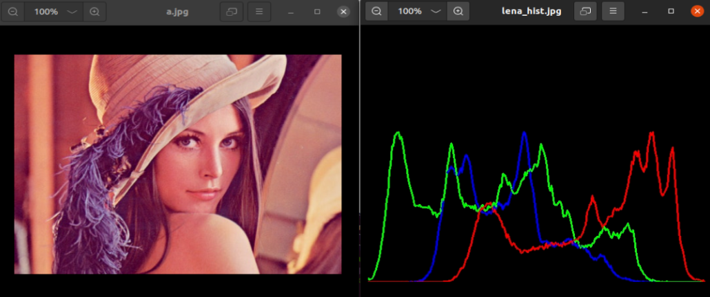
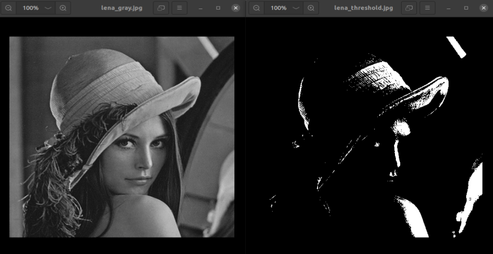
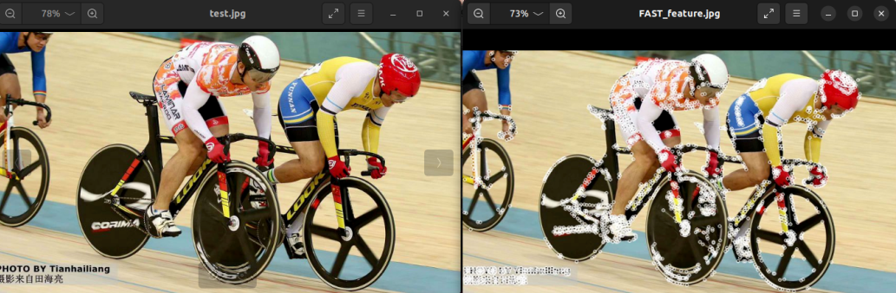
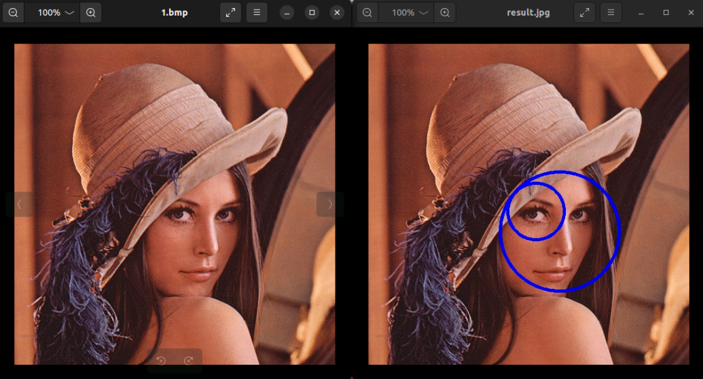

# K230 OpenCV Development Guide

## Introduction to OpenCV

OpenCV stands for Open Source Computer Vision Library, a cross-platform computer vision library. OpenCV was initiated and developed by Intel, released under the BSD license, and can be used freely in commercial and research fields. OpenCV can be used to develop real-time image processing, computer vision, and pattern recognition programs. Canaan Technology provides an optimized and upgraded version of the OpenCV acceleration library for K230, which significantly reduces the inference time of OpenCV operators compared to the original version of OpenCV. The comparison examples are as follows:

| Operator Name | K230 + Original OpenCV | K230 + Upgraded OpenCV |
|---------------|------------------------|------------------------|
| Integral Image Calculation (inter) | 34.5ms | 7.7ms |
| Affine Transformation (warpaffine) | 391.1ms | 34.7ms |

Note:
> The inference times of the above operators are tested under the condition of K230 large core + 1.6GHz.
> Integral Image Calculation (inter) Operator: Input image is a 1280x1080 grayscale image; the integral image type is 32-bit floating point.
> Affine Transformation (warpaffine) Operator: Input image is a 1280x1080 grayscale image; rotated 15 degrees clockwise, scaled by 0.6 times; target image is a 1280x1080 grayscale image.

In addition, the SDK includes a pre-cross-compiled upgraded OpenCV acceleration library (located in the `k230_sdk/src/big/utils/lib/opencv/` path), and users can directly use this static library to compile their executable programs.

## Example of Test Case Compilation

This section explains how to compile executable programs using the pre-set OpenCV static library in the SDK. The SDK includes multiple executable program compilation examples based on OpenCV (located in the `k230_sdk/src/big/utils/examples/opencv/` path). This section explains based on these examples. The directory structure under this path is explained as follows:

```text
|-- 1_opencv_calcHist              # OpenCV example 1
|   |-- CMakeLists.txt             # CMake configuration file for OpenCV example 1
|   `-- opencv_calcHist.cpp        # Source code for OpenCV example 1
|-- 2_opencv_threshold             # OpenCV example 2
|   |-- CMakeLists.txt             # CMake configuration file for OpenCV example 2
|   `-- opencv_threshold.cpp       # Source code for OpenCV example 2
|-- 3_opencv_findContours
|   |-- CMakeLists.txt
|   `-- opencv_findContours.cpp
|-- 4_opencv_features2d
|   |-- CMakeLists.txt
|   `-- opencv_features2d.cpp
|-- 5_opencv_objdetect
|   |-- CMakeLists.txt
|   `-- opencv_objdetect.cpp
|-- CMakeLists.txt               # Overall CMake configuration file
|-- build_app.sh                 # Overall build script
|-- cmake                        # Default CMake configuration
|   |-- Riscv64.cmake
|   `-- link.lds
`-- resources                    # All input images and data required for OpenCV examples
    |-- 1.bmp
    ...
    |-- a.jpg
```

First, run the `build_app.sh` file:

```shell
./build_app.sh
```

If the following prompt appears in the terminal, it means that the executable program has been successfully compiled:

```shell
Install the project...
-- Install configuration: "Release"
-- Installing: /data/zhanglimin/code_kmodel_export_build_inference_k230/k230_sdk/src/big/utils/examples/opencv/out/bin/1_opencv_calcHist.elf
-- Installing: /data/zhanglimin/code_kmodel_export_build_inference_k230/k230_sdk/src/big/utils/examples/opencv/out/bin/2_opencv_threshold.elf
-- Installing: /data/zhanglimin/code_kmodel_export_build_inference_k230/k230_sdk/src/big/utils/examples/opencv/out/bin/3_opencv_findContours.elf
-- Installing: /data/zhanglimin/code_kmodel_export_build_inference_k230/k230_sdk/src/big/utils/examples/opencv/out/bin/4_opencv_features2d.elf
-- Installing: /data/zhanglimin/code_kmodel_export_build_inference_k230/k230_sdk/src/big/utils/examples/opencv/out/bin/5_opencv_objdetect.elf
```

Finally, the `k230_sdk/src/big/utils/examples/opencv/out/bin` folder contains all the compiled elf files:

- `1_opencv_calcHist.elf`
- `2_opencv_threshold.elf`
- `3_opencv_findContours.elf`
- `4_opencv_features2d.elf`
- `5_opencv_objdetect.elf`

## Example of Running Test Cases

Note:
> All input image data required for running the test cases are located in the `k230_sdk/src/big/utils/examples/opencv/resources` path of the SDK.

### opencv_calcHist

The running method of the `1_opencv_calcHist` test case is as follows:

```text
msh /sharefs/bin_opencv>./1_opencv_calcHist.elf
```

The running result of the `1_opencv_calcHist` test case is as follows:



On the left is the original image, and on the right is the pixel histogram information of the 3 channels.

### opencv_threshold

The running method of the `2_opencv_threshold` test case is as follows:

```text
msh /sharefs/bin_opencv>./2_opencv_threshold.elf
```

The running result of the `2_opencv_threshold` test case is as follows:


On the left is the original image, and on the right is the thresholded image.

### opencv_findContours

The running method of the `3_opencv_findContours` test case is as follows:

```text
msh /sharefs/bin_opencv>./3_opencv_findContours.elf
```

The running result of the `3_opencv_findContours` test case is as follows:


On the left is the original image, and on the right is the processed contour information image.

### opencv_features2d

The running method of the `4_opencv_features2d` test case is as follows:

```text
msh /sharefs/bin_opencv>./4_opencv_features2d.elf
```

The running result of the `4_opencv_features2d` test case is as follows:

On the left is the original image, and on the right is the processed feature extraction result image.

### opencv_objdetect

The running method of the `5_opencv_objdetect` test case is as follows:

```text
msh /sharefs/bin_opencv>./5_opencv_objdetect.elf
```

The running result of the `5_opencv_objdetect` test case is as follows:


On the left is the original image, and on the right is the target detection result image for eyes and faces.

## Cross-compilation and Use of the Original Version of OpenCV Library

Note:
> In chapters 1-3, the K230 accelerated version of the OpenCV library provided by Canaan Technology is used. If users wish to use the native OpenCV library for application development, they can refer to this section: first, cross-compile the original version of the OpenCV static library; then, based on the original version of the OpenCV static library, compile the executable program.

### Download OpenCV Source Code

First, use Github to obtain the OpenCV repository. Since OpenCV is from Github, the cloning speed may be slow, which is normal, please be patient:

```shell
git clone https://github.com/opencv/opencv.git
```

OpenCV has many versions, here we use the latest version 4.6.0:

```shell
# Switch to the v4.6.0 branch
git checkout tags/4.6.0 -b v4.6.0-branch
```

### Apply Patch Package

The patch package is located in the SDK at `k230_sdk/src/big/rt-smart/userapps/opencv/v4.6.0`.

First, create a `patch` folder in the root directory of OpenCV and place the patch package into the `patch` folder. The placed directory structure is as follows:

```text
|-- 3rdparty
|-- patch # Patch package for OpenCV
| |-- 0001-****.patch
| |-- 0002-****.patch
| |-- 0003-****.patch
...
| |-- 0011-****.patch
| |-- 0017-****.patch
| |-- 0018-****.patch
|-- CMakeLists.txt
...
|-- include
|-- modules
|-- platforms
|-- samples
```

Then, execute the following command in the root directory of OpenCV to apply the patch:

```shell
git am ./patch/*.patch
```

At this point, the directory structure of OpenCV after applying the patch is as follows:

```text
|-- 3rdparty
|-- patch
|-- CMakeLists.txt
...
|-- apps
|-- build.sh
|-- cmake
|-- data
|-- doc
|-- include
|-- modules
|-- platforms
| |-- android
...
| |-- rt_smart
| | `-- riscv64-gcc.toolchain.cmake # Compilation configuration file for the rt_smart platform
| |-- scripts
| |-- semihosting
| |-- wince
| |-- winpack_dldt
| `-- winrt
|-- samples
`-- version
```

### Cross-compile OpenCV Static Library

First, check whether the toolchain path in the `build.sh` file is correct:

```shell
# Note: The `toolchain_path` may vary depending on the developer's specific environment, and the path prefix may differ, for reference only.
toolchain_path=~/.tools/gnu_gcc/riscv64-linux-musleabi_for_x86_64-pc-linux-gnu/bin
c_compiler=${toolchain_path}/riscv64-unknown-linux-musl-gcc
cxx_compiler=${toolchain_path}/riscv64-unknown-linux-musl-g++

cmake .. -G "Unix Makefiles" -DCMAKE_TOOLCHAIN_FILE="../platforms/rt_smart/riscv64-rvv-gcc.toolchain.cmake" \
-DCMAKE_C_COMPILER=$c_compiler \
-DCMAKE_CXX_COMPILER=$cxx_compiler
```

Then, create a `build` folder, and execute the following commands in the `build` directory:

```shell
source ../build.sh
make -j$(nproc)
make install
```

If no warning messages appear in the terminal during the compilation process, it means the compilation is successful. The compiled products are in `build/install`, which contains the static library files of the original version of OpenCV.

### Compile Executable Program

This section explains how to compile executable programs based on the original version of the OpenCV library by modifying the test cases in Section 2.
First, copy the original version of the OpenCV library to `k230_sdk/src/big/utils/lib/` and name the folder `opencv_rtt`.
Then, delete the accelerated version of the OpenCV library and create a symbolic link to the original version of the OpenCV library:

```shell
cd k230_sdk/src/big/utils/lib/opencv_rtt
rm opencv
ln -s opencv_rtt opencv
```

Then, modify the `CMakeLists.txt` file in each example folder (for example, the `1_opencv_calcHist` folder) and change the linked static library content by deleting the link to the `csi_cv` library:

```shell
# Accelerated version of OpenCV library, using the following link settings
target_link_libraries(${bin} opencv_imgcodecs opencv_imgproc opencv_core libjpeg-turbo libopenjp2 libpng libtiff libwebp zlib csi_cv)
```

The original version of the OpenCV library should be linked as follows:

```shell
target_link_libraries(${bin} opencv_imgcodecs opencv_imgproc opencv_core libjpeg-turbo libopenjp2 libpng libtiff libwebp zlib)
```

Finally, the remaining steps (such as compiling and running the program) are consistent with the accelerated version of OpenCV.
