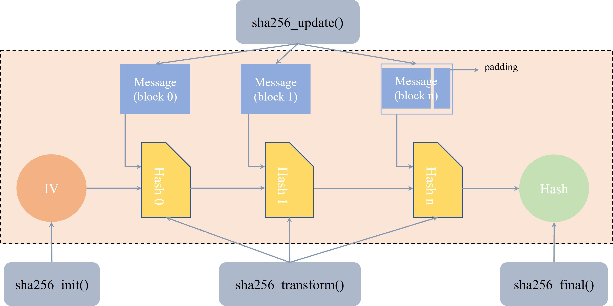

# K230 SHA256 API Reference

## Function Introduction

SHA256 is mainly used to calculate the hash value of data. The SHA256 algorithm is implemented in the rt-smart of the main core to calculate the hash value of data. The code logic is shown in the following figure:



## API Reference

The SHA256 module mainly provides the following API:

- [kd_mpi_cipher_sha256](#kd_mpi_cipher_sha256)

### kd_mpi_cipher_sha256

**Description**:

Calculates the hash value of the message based on the input message.

**Syntax**:

```c
kd_mpi_cipher_sha256(const void *data, k_u32 len, k_u8 *hash);
```

**Parameters**:

| Parameter Name | Description            | Input/Output |
| -------------- | ---------------------- | ------------ |
| data           | Input message          | Input        |
| len            | Length of the input message | Input        |
| hash           | Calculated hash value  | Output       |

**Return Value**:

| Return Value | Description              |
| ------------ | ------------------------ |
| 0            | Success                  |
| Non-zero     | Failure, refer to error code definitions |

**Chip Differences**:

None

**Requirements**:

- Header file: mpi_cipher_api.h
- Library file: libcipher.a

**Notes**:

None

**Example**:

None

**Related Topics**:

None

## Debugging and Print Information

Write a user-mode application *sample_cipher.c* to test the SHA256 functionality.

The test code is already written and located in the *mpp/userapps/sample/sample_cipher* directory. The specific debugging method is as follows:

1. After the main core starts, enter the *bin* directory;
1. Run the *sample_cipher.elf* program;
1. Print information.

The specific print information is as follows:

```shell
msh />cd bin/
msh /bin>./sample_cipher.elf
input = ''
digest: e3b0c442 98fc1c14 9afbf4c8 996fb924 27ae41e4 649b934c a495991b 7852b855
result: PASS

input = 'abc'
digest: ba7816bf 8f01cfea 414140de 5dae2223 b00361a3 96177a9c b410ff61 f20015ad
result: PASS

input = 'abcdbcdecdefdefgefghfghighijhijkijkljklmklmnlmnomnopnopq'
digest: 248d6a61 d20638b8 e5c02693 0c3e6039 a33ce459 64ff2167 f6ecedd4 19db06c1
result: PASS

input = 'The quick brown fox jumps over the lazy dog'
digest: d7a8fbb3 07d78094 69ca9abc b0082e4f 8d5651e4 6d3cdb76 2d02d0bf 37c9e592
result: PASS

input = 'The quick brown fox jumps over the lazy cog'
digest: e4c4d8f3 bf76b692 de791a17 3e053211 50f7a345 b46484fe 427f6acc 7ecc81be
result: PASS

input = 'bhn5bjmoniertqea40wro2upyflkydsibsk8ylkmgbvwi420t44cq034eou1szc1k0mk46oeb7ktzmlxqkbte2sy'
digest: 9085df2f 02e0cc45 5928d0f5 1b27b4bf 1d9cd260 a66ed1fd a11b0a3f f5756d99
result: PASS
```
