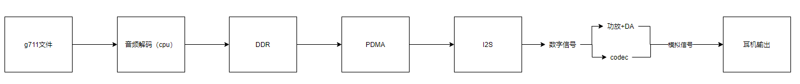
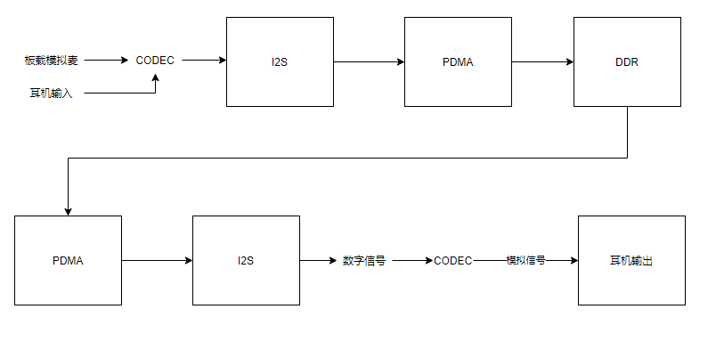
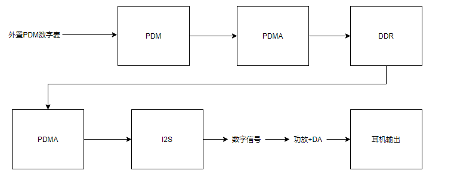
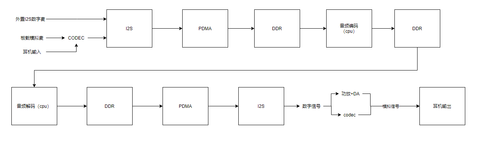
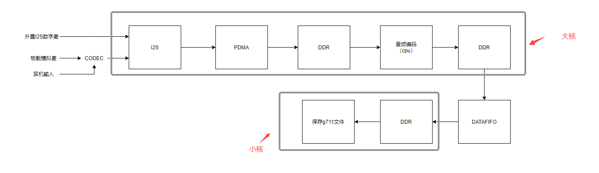
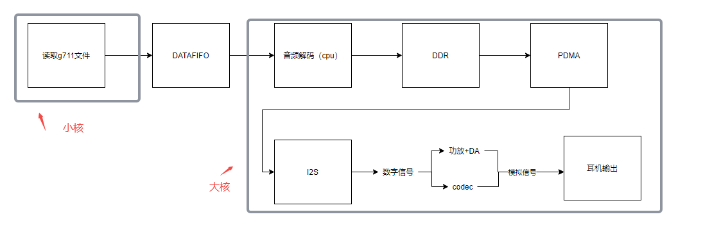
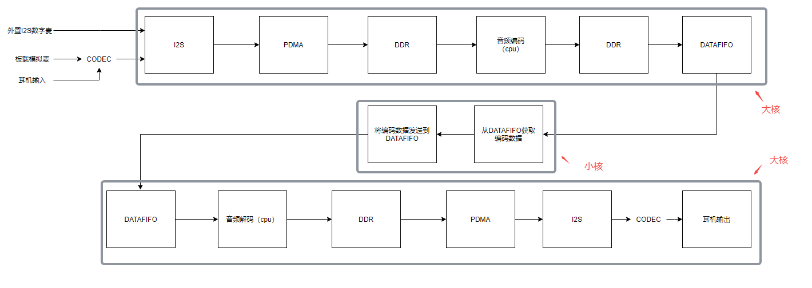

# K230 Audio Practical - Audio Capture, Playback, and Codec

! [cover](../../../zh/images/canaan-cover.png)

Copyright © 2023 Beijing Canaan Creative Information Technology Co., Ltd.

<div style="page-break-after:always"></div>

## Disclaimer

The products, services, or features you purchase are subject to the commercial contracts and terms of Beijing Canaan Creative Information Technology Co., Ltd. ("the Company", hereinafter) and its affiliates. All or part of the products, services, or features described in this document may not be within the scope of your purchase or use. Unless otherwise agreed in the contract, the Company does not provide any express or implied statements or warranties regarding the accuracy, reliability, completeness, merchantability, fitness for a particular purpose, or non-infringement of any representations, information, or content in this document. Unless otherwise agreed, this document is for guidance and reference only.

Due to product version upgrades or other reasons, the content of this document may be updated or modified periodically without any notice.

## Trademark Statement

! [logo](../../../zh/images/logo.png), "Canaan", and other Canaan trademarks are trademarks of Beijing Canaan Creative Information Technology Co., Ltd. and its affiliates. All other trademarks or registered trademarks mentioned in this document are owned by their respective owners.

**Copyright © 2023 Beijing Canaan Creative Information Technology Co., Ltd. All rights reserved.**
No part of this document may be excerpted, reproduced, or disseminated in any form by any means without the written permission of the Company.

<div style="page-break-after:always"></div>

## Table of Contents

[TOC]

### Intended Audience

This document (guide) is primarily intended for the following personnel:

- Technical Support Engineers
- Software Development Engineers

### Abbreviation Definitions

| Abbreviation | Description          |
| ------------ | -------------------- |
| ai           | Audio Input Module   |
| ao           | Audio Output Module  |
| aenc         | Audio Encoding Module|
| adec         | Audio Decoding Module|

### Revision History

| Document Version | Modification Description | Modifier | Date       |
|------------------|---------------------------|----------|------------|
| V1.0             | Initial Version           | Sun Xiaopeng | 2023-07-03 |
|                  |                           |          |            |
|                  |                           |          |            |

## 1. Overview

This document explains how to use the audio demo on the K230 platform to achieve audio capture, playback, encoding, and decoding on either the big core RT-Smart or the small core Linux.

## 2. Environment Preparation

### 2.1 Hardware Environment

- K230-UNSIP-LP3-EVB-V1.0/K230-UNSIP-LP3-EVB-V1.1
- Ubuntu PC 20.04
- Two Type-C USB cables:
  - One connected to UART0/3 for serial communication, UART0 for the small core, and UART3 for the big core.
  - One connected to the DC:5V interface for power supply.
- USB Type-C to Ethernet adapter, connected to USB0.
- One Ethernet cable
- SD card (if using SD card boot or software needs to access the SD card)
- Audio sub-board (needed when using external audio paths), as shown below. Pay attention to the installation position and jumper settings. The audio sub-board is required when using the PDM audio transmission interface and external I2S audio transmission interface; it is not needed when using only the built-in I2S audio transmission interface.

  ! [image-20230703161821233](../../../zh/02_applications/tutorials/images/audio-board.png)

### 2.2 Compiling Programs

#### 2.2.1 Compilation Method

Execute `make rt-smart` in the `k230_sdk` directory to generate `sample_audio.elf` in the `k230_sdk/src/big/mpp/userapps/sample/elf` directory for the big core RT-Smart audio demo.
Execute `make cdk-user` in the `k230_sdk` directory to generate `sample_audio` in the `k230_sdk/src/common/cdk/user/out/little/` directory for the small core Linux audio demo.
By default, after the board starts, the big core RT-Smart system's `sample_audio.elf` is in `/sharefs`, and the small core audio demo `sample_audio` is in `/mnt`.

#### 2.2.2 Code Location

Program source directories:
Big core audio demo source: `k230_sdk/src/big/mpp/userapps/sample/sample_audio`
Small core audio demo source: `k230_sdk/src/common/cdk/user/mapi/sample/sample_audio`

## 3. Big Core Audio Practical

The big core demo file is `sample_audio.elf`, supporting functions such as audio capture (ai), audio playback (ao), audio encoding (aenc), and audio decoding (adec).

### 3.1 Parameter Description

| Parameter Name | Description | Default Value |
|----------------|-------------|---------------|
| help           | Print command line parameter information | - |
| samplerate     | Set audio sampling rate, valid values `[8000,12000,16000,24000,32000,44100,48000,96000,192000]` | 44100 |
| enablecodec    | Use built-in (1) or external (0) link for I2S, valid values: 0, 1 | 0 |
| bitwidth       | Sampling precision, valid values: 16, 24, 32 | 16 |
| channels       | Number of channels, valid values: 1, 2 | 2 |
| filename       | Input or output file name | - |
| type           | Function type, valid values: [0,12], specific values refer to the table below | 0 |

| Type Value | Function Description |
|------------|-----------------------|
| 0          | I2S audio capture     |
| 1          | PDM audio capture     |
| 2          | I2S audio playback    |
| 3          | AI->AO loopback using API, AI as I2S, AO as I2S |
| 4          | AI->AO loopback using module binding, AI as I2S, AO as I2S |
| 5          | AI->AO loopback using API, AI as PDM, AO as I2S |
| 6          | AI->AO loopback using module binding, AI as PDM, AO as I2S |
| 7          | Audio encoding: AI->AENC using module binding, AI as I2S, AENC as G711A encoding format |
| 8          | Audio decoding: ADEC->AO using module binding, AO as I2S, ADEC as G711A decoding format |
| 9          | Audio encoding: AI->AENC using API, AI as I2S, AENC as G711A encoding format |
| 10         | Audio decoding: ADEC->AO using API, AO as I2S, ADEC as G711A decoding format |
| 12         | AI->AENC, ADEC->AO loopback using module binding, AI as I2S, AO as I2S |

### 3.2 Audio Capture

Audio capture supports both I2S and PDM audio transmission interfaces. I2S audio capture supports two groups, which can work simultaneously; PDM audio capture supports four groups, which can also work simultaneously.

I2S audio capture: Supports two groups. The first group can be selected as either built-in or external path, while the second group is fixed as an external path. When the first group is used as a built-in path, the left channel sound is from the headphone line-in, and the right channel sound is from the onboard analog mic input. In mono mode, the sound is fixed as the onboard analog mic input. When used as an external path, both left and right channel sounds are from the digital mic input on the sub-board.

! [image-20230704100947965](../../../zh/02_applications/tutorials/images/audio-capture-i2s.png)

PDM audio capture: Requires an external sub-board, supports four groups, and can work simultaneously. Each group supports single/dual-channel capture, with each channel's sound coming from the digital mic input on the sub-board.

! [image-20230704101309168](../../../zh/02_applications/tutorials/images/audio-capture-pdm.png)

### 3.2.1 I2S Audio Capture

After the development board starts, run the following test program on the big core: `/sharefs/sample_audio.elf -type 0 -enablecodec 1 -samplerate 48000 -bitwidth 24 -channels 2 -filename /sharefs/test.wav`
The demo uses a sampling rate of 48000, an internal codec path, a sampling precision of 24-bit, dual-channel, and saves the captured data in WAV format to the `/sharefs/test.wav` file. It exits after capturing 15 seconds of data.

```shell
/sharefs/sample_audio.elf -type 0 -enablecodec 1 -samplerate 48000 -bitwidth 24 -channels 2 -filename /sharefs/test.wav
audio type:0,sample rate:48000,bit width:24,channels:2,enablecodec:1
mmz blk total size:8.12 MB
vb_set_config ok
sample ai i2s module
audio i2s set clk freq is 3072000(3072000),ret:1
audio codec adc clk freq is 12288000(12288000)
audio_save_init get vb block size:4320044
======kd_mpi_sys_mmap total size:4320044
[0s] timestamp 0 us,curpts:3232823
[1s] timestamp 1000000 us,curpts:4232823
[2s] timestamp 2000000 us,curpts:5232823
[3s] timestamp 3000000 us,curpts:6232823
[4s] timestamp 4000000 us,curpts:7232823
[5s] timestamp 5000000 us,curpts:8232823
[6s] timestamp 6000000 us,curpts:9232823
[7s] timestamp 7000000 us,curpts:10232823
[8s] timestamp 8000000 us,curpts:11232823
[9s] timestamp 9000000 us,curpts:12232823
[10s] timestamp 10000000 us,curpts:13232823
[11s] timestamp 11000000 us,curpts:14232823
[12s] timestamp 12000000 us,curpts:15232823
[13s] timestamp 13000000 us,curpts:16232823
dump binary memory test1.wav 0x18242000 0x18660b2c
[14s] timestamp 14000000 us,curpts:17232823
destroy vb block
sample done
```

### 3.2.2 PDM Audio Capture

After the development board starts, run the following test program on the big core: `/sharefs/sample_audio.elf -type 1 -samplerate 16000 -bitwidth 16 -channels 2 -filename /sharefs/test.wav`
The demo uses a sampling rate of 16000, an external audio path (requires an audio sub-board), a sampling precision of 16-bit, dual-channel, and saves the captured data in WAV format to the `/sharefs/test.wav` file. It exits after capturing 15 seconds of data.

```shell
/sharefs/sample_audio.elf -type 1 -samplerate 16000 -bitwidth 16 -channels 2 -filename /sharefs/test.wav
audio type:1,sample rate:16000,bit width:16,channels:2,enablecodec:0
mmz blk total size:2.71 MB
vb_set_config ok
sample ai pdm module
audio_sample_get_ai_pdm_data channel_total:1,rec_channel:0,oversample:0
pdm in init clk freq is 1536000
pdm in set clk freq is 512000(512000)
audio_save_init get vb block size:960044
======kd_mpi_sys_mmap total size:960044
[0s] timestamp 0 us,curpts:1006669
[1s] timestamp 1000000 us,curpts:2006669
[2s] timestamp 2000000 us,curpts:3006669
[3s] timestamp 3000000 us,curpts:4006669
[4s] timestamp 4000000 us,curpts:5006669
[5s] timestamp 5000000 us,curpts:6006669
[6s] timestamp 6000000 us,curpts:7006669
[7s] timestamp 7000000 us,curpts:8006669
[8s] timestamp 8000000 us,curpts:9006669
[9s] timestamp 9000000 us,curpts:10006669
[10s] timestamp 10000000 us,curpts:11006669
[11s] timestamp 11000000 us,curpts:12006669
[12s] timestamp 12000000 us,curpts:13006669
[13s] timestamp 13000000 us,curpts:14006669
dump binary memory test1.wav 0x180c1000 0x181ab62c
[14s] timestamp 14000000 us,curpts:15006669
destroy vb block
sample done
```

### 3.3 Audio Playback

Audio playback supports the I2S audio transmission interface. I2S audio capture supports two groups, which can work simultaneously. The first group can be selected as either built-in or external path, while the second group is fixed as an external path. When the first group is used as a built-in path, the sound output is from the onboard headphone jack; when using the external path, the sound output is from the headphone jack on the sub-board.

! [image-20230704104012443](../../../zh/02_applications/tutorials/images/audio-play-i2s.png)

#### 3.3.1 I2S Audio Playback

After the development board starts, run the following test program on the big core: `./sample_audio.elf -type 2 -filename test.wav -enablecodec 1`
The demo automatically sets the audio properties based on the WAV file format, loops the playback of the WAV file, and you can hear the sound by plugging headphones into the onboard headphone jack. Press any key to exit the demo.

```shell
./sample_audio.elf -type 2 -filename test.wav -enablecodec 1
audio type:2,sample rate:44100,bit width:16,channels:2,enablecodec:1
mmz blk total size:7.46 MB
vb_set_config ok
enter any key to exit
sample ao i2s module
========read_wav_header:headerlen:44,channel:2,samplerate:16000,bitpersample:16
open file:test.wav ok,file size:960044,data size:960000,wav header size:44
=======_get_audio_frame virt_addr:0x10010e000
audio i2s set clk freq is 1024000(1024000),ret:1
audio init codec dac clk freq is 11289600
audio set codec dac clk freq is 4096000(4096000)
read file again
q
disable ao audio
destroy vb block
sample done
```

### 3.4 Audio Codec

The built-in G711a/u codec module is available, and other codec formats can be supported by registering external codecs. All codec modules use CPU software codecs and support only 16-bit sampling precision.

The audio encoding storage process is as follows, with the data flow being ai->aenc.

! [image-20230704105447088](../../../zh/02_applications/tutorials/images/audio-capture-i2s-encode.png)

The audio decoding playback process is as follows, with the data flow being adec->ao.

!


#### 3.4.1 Audio Encoding

After the development board starts, run the following test program on the big core: `./sample_audio.elf -type 7 -filename /sharefs/test.g711a -channels 2 -samplerate 8000 -bitwidth 16 -enablecodec 1`
This encodes the data collected by ai (dual-channel, sampling rate 8000, internal codec path, sampling precision 16) into g711a format and saves it to a file. Press any key to exit the demo.

```shell
./sample_audio.elf -type 7 -filename /sharefs/test.g711a -channels 2 -samplerate 8000 -bitwidth 16 -enablecodec 1
audio type:7,sample rate:8000,bit width:16,channels:1,enablecodec:1
mmz blk total size:1.35 MB
vb_set_config ok
enter any key to exit
sample aenc module (sysbind)
audio i2s set clk freq is 512000(512000),ret:1
audio codec adc clk freq is 2048000(2048000)
q
destroy vb block
sample done
```

#### 3.4.2 Audio Decoding

After the development board starts, run the following test program on the big core: `./sample_audio.elf -type 8 -filename /sharefs/test.g711a -channels 2 -samplerate 8000 -bitwidth 16 -enablecodec 1`
This decodes the g711a format file (sampling rate 8000, 2 channels, sampling precision 16) and plays it through ao (internal codec path). Press any key to exit the demo.

```shell
./sample_audio.elf -type 8 -filename /sharefs/test.g711a -channels 2 -samplerate 8000 -bitwidth 16 -enablecodec 1
audio type:8,sample rate:8000,bit width:16,channels:2,enablecodec:1
mmz blk total size:1.35 MB
vb_set_config ok
enter any key to exit
sample adec module (sysbind)
audio i2s set clk freq is 512000(512000),ret:1
audio init codec dac clk freq is 4096000
audio set codec dac clk freq is 2048000(2048000)
adec_bind_call_back dev_id:0 chn_id:0
read file again
q
adec_bind_call_back dev_id:0 chn_id:0
destroy vb block
sample done
```

### 3.5 Loopback Test

### 3.5.1 I2S Capture and Playback Loopback

After the development board starts, run the following test program on the big core: `./sample_audio.elf -type 4 -enablecodec 1 -bitwidth 16 -samplerate 48000 -channels 2`
This simultaneously runs the ai and ao modules, real-time outputting the sound data collected by ai (sampling precision 16, sampling rate 48000, dual-channel) to ao (sampling precision 16, sampling rate 48000, dual-channel) for playback, using the internal codec path. Press any key to exit the demo. The specific flowchart is as follows.



```shell
./sample_audio.elf -type 4 -enablecodec 1 -bitwidth 16 -samplerate 48000 -channels 2
audio type:4,sample rate:48000,bit width:16,channels:2,enablecodec:1
mmz blk total size:8.12 MB
vb_set_config ok
enter any key to exit
sample ai(i2s) bind ao module
audio i2s set clk freq is 3072000(3072000),ret:1
audio codec adc clk freq is 12288000(12288000)
audio i2s set clk freq is 3072000(3072000),ret:1
audio init codec dac clk freq is 2048000
audio set codec dac clk freq is 12288000(12288000)
q
disable ao module
disable ai module
release vb block
destroy vb block
sample done
```

### 3.5.2 PDM Capture and Playback Loopback

After the development board starts, run the following test program on the big core: `./sample_audio.elf -type 6 -bitwidth 32 -samplerate 48000 -channels 2 -enablecodec 0`
This simultaneously runs the ai and ao modules, real-time outputting the sound data collected by ai (sampling precision 32, sampling rate 48000, dual-channel) to ao (sampling precision 32, sampling rate 48000, dual-channel) for playback, using the external sub-board path. Press any key to exit the demo. The specific flowchart is as follows.



```shell
./sample_audio.elf -type 6 -bitwidth 32 -samplerate 48000 -channels 2 -enablecodec 0
audio type:6,sample rate:48000,bit width:32,channels:2,enablecodec:0
mmz blk total size:8.12 MB
vb_set_config ok
enter any key to exit
sample ai(pdm) bind ao module
pdm in init clk freq is 3072000
pdm in set clk freq is 3072000(3072000)
audio i2s set clk freq is 3072000(3072000),ret:1
q
disable ao module
disable ai module
release vb block
destroy vb block
sample done
```

### 3.5.3 Codec Loopback

After the development board starts, run the following test program on the big core: `./sample_audio.elf -type 12 -samplerate 44100`
This simultaneously runs the ai, adec, aenc, and ao modules, binds ai to aenc, and adec to ao, sending the data obtained from aenc to adec, thus achieving a loopback effect. The audio sampling precision is fixed at 16-bit, and the internal codec path is used. Press any key to exit the demo. The data flow is as follows:



```shell
./sample_audio.elf -type 12 -samplerate 44100
audio type:12,sample rate:44100,bit width:16,channels:2,enablecodec:0
mmz blk total size:7.46 MB
vb_set_config ok
enter any key to exit
sample ai->aenc  adec->ao module (loopback)
Force the sampling accuracy to be set to 16, use inner codec
audio i2s set clk freq is 2822400(2822400),ret:1
audio codec adc clk freq is 11289600(11289600)
audio i2s set clk freq is 2822400(2822400),ret:1
audio init codec dac clk freq is 12288000
audio set codec dac clk freq is 11289600(11289600)
adec_bind_call_back dev_id:0 chn_id:0
[0s] g711 stream timestamp 0 us, curpts:1059296
[1s] g711 stream timestamp 1000000 us, curpts:2059296
[2s] g711 stream timestamp 2000000 us, curpts:3059296
[3s] g711 stream timestamp 3000000 us, curpts:4059296
[4s] g711 stream timestamp 4000000 us, curpts:5059296
[5s] g711 stream timestamp 5000000 us, curpts:6059296
[6s] g711 stream timestamp 6000000 us, curpts:7059296
[7s] g711 stream timestamp 7000000 us, curpts:8059296
[8s] g711 stream timestamp 8000000 us, curpts:9059296
q
adec_bind_call_back dev_id:0 chn_id:0
destroy vb block
sample done
```

## 4. Small Core Audio Practical

The small core demo file is `sample_audio`, supporting functions such as audio capture (ai), audio playback (ao), audio encoding (aenc), and audio decoding (adec).

### 4.1 Parameter Description

| Parameter Name | Description | Default Value |
|----------------|-------------|---------------|
| help           | Print command line parameter information | - |
| samplerate     | Set audio sampling rate, valid values `[8000,12000,16000,24000,32000,44100,48000,96000,192000]` | 44100 |
| enablecodec    | Use built-in (1) or external (0) link for I2S, valid values: 0, 1 | 0 |
| channels       | Number of channels, valid values: 1, 2 | 2 |
| filename       | Input or output file name | - |
| type           | Function type, valid values: [0,2], specific values refer to the table below | 0 |

| Type Value | Function Description |
|------------|-----------------------|
| 0          | Audio capture and encoding: ai->aenc, using module binding (ai binds to aenc), ai as I2S interface, aenc as G711A encoding format, sampling precision fixed at 16-bit. |
| 1          | Audio decoding and playback: adec->ao, using module binding (adec binds to ao), ao as I2S interface, adec as G711A decoding format, sampling precision fixed at 16-bit. |
| 2          | ai->aenc, adec->ao loopback: using module binding (ai binds to aenc, adec binds to ao). ai as I2S interface, aenc as G711A format, adec as G711A format, ao as I2S interface, sampling precision fixed at 16-bit. |

### 4.2 Audio Capture and Encoding

After the development board starts, run the program on the big core: `/sharefs/sample_sys_init.elf &`
Then run the following program on the small core: `./sample_audio -type 0 -samplerate 8000 -enablecodec 1 -channels 1 -filename test.g711a`
This encodes the data collected by ai (mono-channel, sampling rate 8000, internal codec path, sampling precision 16) into g711a format and saves it to a file. Press 'q' to exit the demo. The data flowchart is as follows:




```shell
./sample_audio -type 0 -samplerate 8000 -enablecodec 1 -channels 1 -filename test.g711a
audio type:0,sample rate:8000,channels:1,enablecodec:1,filename:test.g711a
mmz blk total size:0.38 MB
[AENC_S] [Func]:_init_datafifo [Line]:174 [Info]:_aenc_datafifo_init_slave ok, datafifo_phyaddr:0x18061000, data_hdl:0x18061000
enter 'q' key to exit
_aenc_dataproc chn_num:0, stream data:0x18003c00, data len:320, seq:0, timestamp:99306
_aenc_dataproc chn_num:0, stream data:0x18005a00, data len:320, seq:1, timestamp:139306
_aenc_dataproc chn_num:0, stream data:0x18007800, data len:320, seq:2, timestamp:179306
_aenc_dataproc chn_num:0, stream data:0x18009600, data len:320, seq:3, timestamp:219306
_aenc_dataproc chn_num:0, stream data:0x1800b400, data len:320, seq:4, timestamp:259306
_aenc_dataproc chn_num:0, stream data:0x1800d200, data len:320, seq:5, timestamp:299306
_aenc_dataproc chn_num:0, stream data:0x1800f000, data len:320, seq:6, timestamp:339306
_aenc_dataproc chn_num:0, stream data:0x18010e00, data len:320, seq:7, timestamp:379306
_aenc_dataproc chn_num:0, stream data:0x18012c00, data len:320, seq:8, timestamp:419306
_aenc_dataproc chn_num:0, stream data:0x18014a00, data len:320, seq:9, timestamp:459306
_aenc_dataproc chn_num:0, stream data:0x18016800, data len:320, seq:10, timestamp:499306
_aenc_dataproc chn_num:0, stream data:0x18018600, data len:320, seq:11, timestamp:539306
_aenc_dataproc chn_num:0, stream data:0x1801a400, data len:320, seq:12, timestamp:579306
_aenc_dataproc chn_num:0, stream data:0x1801c200, data len:320, seq:13, timestamp:619306
_aenc_dataproc chn_num:0, stream data:0x1801e000, data len:320, seq:14, timestamp:659306
_aenc_dataproc chn_num:0, stream data:0x1801fe00, data len:320, seq:15, timestamp:699306
_aenc_dataproc chn_num:0, stream data:0x18021c00, data len:320, seq:16, timestamp:739306
_aenc_dataproc chn_num:0, stream data:0x18023a00, data len:320, seq:17, timestamp:779306
_aenc_dataproc chn_num:0, stream data:0x18025800, data len:320, seq:18, timestamp:819306
_aenc_dataproc chn_num:0, stream data:0x18027600, data len:320, seq:19, timestamp:859306
_aenc_dataproc chn_num:0, stream data:0x18029400, data len:320, seq:20, timestamp:899306
_aenc_dataproc chn_num:0, stream data:0x1802b200, data len:320, seq:21, timestamp:939306
_aenc_dataproc chn_num:0, stream data:0x1802d000, data len:320, seq:22, timestamp:979306
_aenc_dataproc chn_num:0, stream data:0x1802ee00, data len:320, seq:23, timestamp:1019306
_aenc_dataproc chn_num:0, stream data:0x18030c00, data len:320, seq:24, timestamp:1059306
_aenc_dataproc chn_num:0, stream data:0x18032000, data len:320, seq:25, timestamp:1099306
_aenc_dataproc chn_num:0, stream data:0x18033400, data len:320, seq:26, timestamp:1139306
_aenc_dataproc chn_num:0, stream data:0x18034800, data len:320, seq:27, timestamp:1179306
_aenc_dataproc chn_num:0, stream data:0x18035c00, data len:320, seq:28, timestamp:1219306
_aenc_dataproc chn_num:0, stream data:0x18037000, data len:320, seq:29, timestamp:1259306
q
sample done
```

### 4.3 Audio Decoding and Playback

After the development board starts, run the program on the big core: `/sharefs/sample_sys_init.elf &`
Then run the following test program on the small core: `./sample_audio -type 1 -samplerate 8000 -enablecodec 1 -channels 1 -filename test.g711a`
This decodes the g711a format file (sampling rate 8000, 1 channel, sampling precision 16) and outputs it through ao (internal codec path). Press 'q' to exit the demo.



```shell
./sample_audio -type 1 -samplerate 8000 -enablecodec 1 -channels 1 -filename test.g711a
audio type:1, sample rate:8000, channels:1, enablecodec:1, filename:test.g711a
mmz blk total size:0.38 MB
[ADEC_S] [Func]:_init_datafifo [Line]:189 [Info]:_adec_datafifo_init_slave ok, datafifo_phyaddr:0x18061000, data_hdl:0x18061000
enter 'q' key to exit
[ADEC_S] [Func]:_datafifo_release_func [Line]:157 [Info]:_datafifo_release_func, adec_hdl:0
read file again
read file again
read file again
q
sample done
```

### 4.4 Codec Loopback

After the development board starts, run the following program on the big core: `/sharefs/sample_sys_init.elf &`
Then run the following test program on the small core: `./sample_audio -type 2 -samplerate 48000 -enablecodec 1 -channels 2`
This simultaneously runs the ai, adec, aenc, and ao modules, binds ai (sampling rate 48000, 2 channels, sampling precision 16) to aenc (g711a), and adec (g711a) to ao (sampling rate 48000, 2 channels, sampling precision 16). The data obtained from aenc is sent to adec, thus achieving a loopback effect.



```shell
./sample_audio -type 2 -samplerate 48000 -enablecodec 1 -channels 2
audio type:2, sample rate:48000, channels:2, enablecodec:1, filename:
mmz blk total size:2.26 MB
[AENC_S] [Func]:_init_datafifo [Line]:174 [Info]:_aenc_datafifo_init_slave ok, datafifo_phyaddr:0x18242000, data_hdl:0x18242000
[ADEC_S] [Func]:_init_datafifo [Line]:189 [Info]:_adec_datafifo_init_slave ok, datafifo_phyaddr:0x18243000, data_hdl:0x18243000
enter 'q' key to exit
[ADEC_S] [Func]:_datafifo_release_func [Line]:157 [Info]:_datafifo_release_func, adec_hdl:0
q
sample done
```
