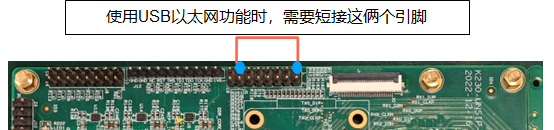
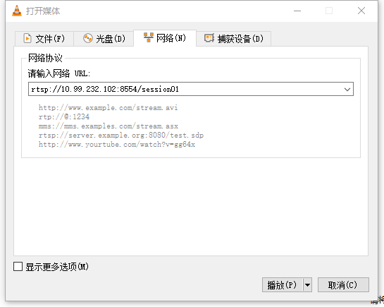

# K230 Coding Practice - Setting Up and Streaming with RTSP Server


Copyright © 2023 Beijing Canaan Creative Information Technology Co., Ltd.

<div style="page-break-after:always"></div>

## Disclaimer

The products, services, or features you purchase are subject to the commercial contracts and terms of Beijing Canaan Creative Information Technology Co., Ltd. (hereinafter referred to as "the company") and its affiliates. Some or all of the products, services, or features described in this document may not be within the scope of your purchase or use. Unless otherwise agreed in the contract, the company does not make any express or implied statements or warranties regarding the accuracy, reliability, completeness, merchantability, fitness for a particular purpose, or non-infringement of any representations, information, or content in this document. Unless otherwise agreed, this document is for reference only.

Due to product version upgrades or other reasons, the content of this document may be updated or modified without any notice.

## Trademark Statement

, "Canaan" and other Canaan trademarks are trademarks of Beijing Canaan Creative Information Technology Co., Ltd. and its affiliates. All other trademarks or registered trademarks mentioned in this document are owned by their respective owners.

**Copyright © 2023 Beijing Canaan Creative Information Technology Co., Ltd. All rights reserved.**
Without written permission from the company, no unit or individual is allowed to excerpt, copy part or all of the content of this document, or disseminate it in any form.

<div style="page-break-after:always"></div>

## 1. Environment Setup

### 1.1 Hardware Environment

- K230-USIP-LP3-EVB-V1.0/K230-UNSIP-LP3-EVB-V1.1
- Ubuntu PC 20.04
- Type-C USB cable * 2
  - One connected to UART0/3 for serial communication, UART0 corresponds to the small core, UART3 corresponds to the large core.
  - One connected to the DC:5V interface for power supply.
- USB Type-C to Ethernet, connected to USB0.
- One Ethernet cable
- SD card (if using SD card boot or software needs access to SD card)
- Camera sub-board (IMX335, used for RTSP audio-video streaming)
- Headphones (for voice intercom)
- One Dupont wire, connect USB0_OTG_EN to high level as shown below



Note: Audio intercom requires two sets of devices.

### 1.2 Software Environment

- K230 SDK
- VLC Player

### 1.3 Preparation for Running

To execute the RTSP program on the EVB, you need to start the network service and ensure that the PC and EVB board are on the same subnet.

## 2. Source Code Introduction

### 2.1 Source Code Location

The RTSP-related demos included in the SDK are located in the `k230_sdk/src/common/cdk/user/samples` directory, which includes:

- `rtsp_demo`: Audio-video streaming program
- `rtsp_server`: Voice intercom server-side program
- `backchannel_client`: Voice intercom client-side program

### 2.2 Source Code Introduction

The K230 SDK uses a dual-core architecture. The small core runs a Linux system to implement network control services, while the large core runs the RTT system to control audio-video hardware. The small core is responsible for booting the large core during startup. The small and large cores communicate through inter-core communication for message passing and memory sharing.

The small core network service ported the live source code, located at `k230_sdk/src/common/cdk/user/thirdparty/live`. Audio uses G711 encoding. In audio-video streaming, the default maximum resolution of the video is related to the configured sensor_type, with the default maximum resolution being 1920x1080.

#### 2.2.1 Main Steps of the Program

##### 2.2.1.1 Audio-Video Streaming Program

1. `new StreamingPlayer`
   - Initialize inter-core communication.
   - Configure video buffer.
1. `InitVicap`: Initialize the camera.
1. `CreateSession`:
   - Create server session.
   - Create and start the audio input channel with a sampling rate of 44.1kHz and a sample width of 16 bits.
   - Initialize audio encoding using G711A encoding.
   - Create a video encoding channel and enable IDR frames.
1. `Start`:
   - Start the video encoding channel and bind it to VO.
   - Start the video encoding channel and bind the video input to video encoding.
   - Start audio-video streaming.

##### 2.2.1.2 Voice Intercom Program

1. `Init`:
   - Create server session.
   - Initialize inter-core communication.
   - Configure video buffer.
   - Create and start the audio input channel with a sampling rate of 8kHz and a sample width of 16 bits.
   - Create an audio encoding channel using G711U encoding.
   - Create audio output and decoding channels, and bind audio decoding to audio output.
1. `Start`:
   - Start audio streaming.
   - Start the video encoding channel and bind the video input to video encoding.

## 3. Program Execution

### 3.1 RTSP Audio-Video Streaming

#### 3.1.1 Parameter Description

| Parameter Name | Description | Range | Default Value |
|:--|:--|:--|:--|
| help | Print command line parameter information | - | - |
| n | Number of sessions | `[1, 3]` | 1 |
| t | Encoding type | h264, h265, mjpeg | h264 |
| w | Video encoding width | `[640, 1920]` | 1280 |
| h | Video encoding height | `[480, 1080]` | 720 |
| s | Sensor type | Refer to camera sensor documentation | 7 |

Refer to the `k230_docs/zh/01_software/board/mpp/K230_Camera_Sensor 适配指南.md` document for the description of k_vicap_sensor_type.

#### 3.1.2 Compile the Program

Execute `make cdk-user` in the `k230_sdk` directory to generate `rtsp_demo` in the `k230_sdk/src/common/cdk/user/out/little/` directory.

Program source code directory: `k230_sdk/src/common/cdk/user/samples/rtsp_demo`

#### 3.1.3 Run the Program

Supports simultaneous streaming of audio-video streams to the RTSP server, where audio-video encoding is achieved through the `mapi venc&aenc` interface. After streaming, the stream can be pulled through the URL, currently supporting two URLs for streaming.

1. Execute on the large core: `cd /sharefs; ./sample_sys_init.elf`
1. Execute on the small core: `./rtsp_demo`
1. After running rtsp_demo on the small core, URLs like `rtsp://ip:8554/session0` and `rtsp://ip:8554/session01` will be printed. These URLs can be pulled using VLC for playback.
   VLC streaming method: Media -> Open Network Stream -> Enter the corresponding URL in the opened window.
   

### 3.2 Voice Intercom

Used for the bidirectional transmission and processing of audio data. Voice intercom involves two ends, both of which can simultaneously capture, encode, and send audio data to the other end, while also receiving and decoding audio data from the other end for output. The current implementation references ONVIF, extending the RTSP protocol with backchannel to support sending audio data from the client to the server. The server and client refer to the two ends of the voice intercom in the following text.

1. The audio stream format is G711 mu-Law.
1. The server side implements real-time audio capture, encoding, and sending, as well as receiving and decoding audio data from the client through the backchannel for output.
1. The client side implements audio stream reception, decoding, and playback, as well as real-time audio capture, G711 mu-Law encoding, and sending to the server through the backchannel.
1. Only supports one-to-one intercom (only supports one backchannel).
1. Does not support echo cancellation (the device side needs to output audio to headphones, not speakers).

#### 3.2.1 Compile the Program

Execute `make cdk-user` in the `k230_sdk` directory to generate `rtsp_server` and `backclient_test` in the `k230_sdk/src/common/cdk/user/out/little/` directory.

Program source code directories:
`k230_sdk/src/common/cdk/user/samples/rtsp_demo/rtsp_server`
`k230_sdk/src/common/cdk/user/samples/rtsp_demo/backchannel_client`

#### 3.2.2 RTSP Server Parameter Description

| Parameter Name | Description | Range | Default Value |
|:--|:--|:--|:--|
| h | Print command line parameter information | - | - |
| v | Whether to create a video session | - | - |
| t | Encoding type | h264, h265 | h265 |
| w | Video encoding width | `[640, 1920]` | 1280 |
| h | Video encoding height | `[480, 1080]` | 720 |
| b | Video encoding bitrate | - | 2000 |
| a | Voice change setting | `[-12, 12]` | 0 |
| s | Sensor type | Refer to camera sensor documentation | 7 |

Refer to the `k230_docs/zh/01_software/board/mpp/K230_Camera_Sensor 适配指南.md` document for the description of k_vicap_sensor_type.

#### 3.2.3 Run the Program

Connect two EVBs to the same subnet, with one as the server and one as the client. After fully booting the small and large cores:

Server side runs the following commands:

- Execute on the large core: `cd /sharefs; ./sample_sys_init.elf`
- Execute on the small core: `cd /mnt; ./rtsp_server` (After running rtsp_server, URLs like `rtsp://<server_ip>:8554/BackChannelTest` will be printed)

Client side runs the following commands:

- Execute on the large core: `cd /sharefs; ./sample_sys_init.elf`
- Execute on the small core: `./backclient_test rtsp://<server_ip>:8554/BackChannelTest`

The command for running backclient_test: `./backclient_test <rtsp_url> <out_type>`, where rtsp_url is the RTSP address, and out_type is the VO output connect type. Refer to the `k230_docs/zh/01_software/board/mpp/K230_视频输出_API 参考.md` document for the description of k_connector_type, with out_type defaulting to 0.

## 4. Running sharefs

The large core's `sample_sys_init.elf` is not loaded by default. It can be run on the large core through the following two methods:

1. Modify the `mpp-apps` compile script in `k230_sdk/Makefile`, add the following command before `cd -;`, and execute `make rt-smart;make build-image` in the `k230_sdk` directory. The generated image file will include `sample_sys_init.elf` in the large core's `/bin` directory.

    ```sh
    cp userapps/sample/elf/sample_sys_init.elf $(RTSMART_SRC_DIR)/userapps/root/bin/; \
    ```

1. After booting the small and large cores, transfer the executable program to the EVB board through sharefs and tftp.
   /sharefs is used to share files between the small and large cores. Both cores can access their respective /sharefs directories to achieve shared file system functionality. The large core's file system is read-only. The /sharefs directory can be mounted on an SD card partition or a PC's NFS directory, and file transfer can be achieved through tftp.

    ```sh
    mount /dev/mmcblk1p4 /sharefs # Mount /sharefs to the SD card partition
    ```

    ```sh
    mount -t nfs -o nolock <ipaddr>:<nfs_path> /sharefs/ # Mount /sharefs to the NFS path directory of the IP address
    ```

    The tftp command is as follows:

    ```sh
    tftp -gr <filename> <ipaddr> # Transfer the file <filename> from the IP address host to the board
    tftp -pl <filename> <ipaddr> # Transfer the file <filename> from the board to the IP address host
    ```
