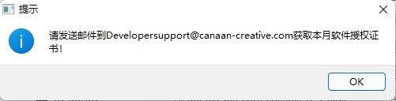
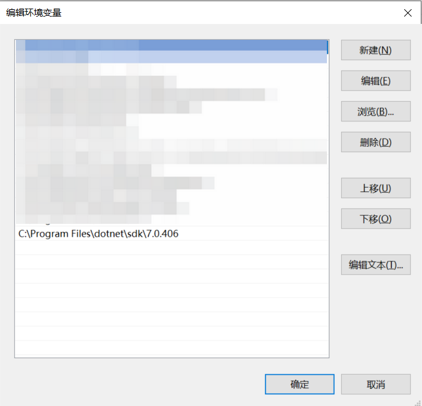

# AI Cube Frequently Asked Questions

## AI Cube Usage Issues

### Issue 1: License prompt appears when AI Cube is opened

**Answer:** AI Cube uses a license verification mechanism. To enter AI Cube, a license for the current month is required. Users can send an email to [Developersupport@canaan-creative.com](mailto:Developersupport@canaan-creative.com) to apply for a license for the current month. Our professional team will provide you with license support.

### Issue 2: AI Cube crashes or becomes unresponsive when running

**Answer:** When encountering a crash issue, first refer to the [AI Cube User Guide](https://kendryte-download.canaan-creative.com/developer/common/AI_Cube_V1.2%E7%94%A8%E6%88%B7%E6%8C%87%E5%8D%97.pdf) to check if the Nvidia graphics driver and dotnet are correctly installed.

Possible causes include:

* The first startup of AI Cube requires waiting. Users can manually execute AI Cube.exe in the AI Cube directory to speed up the opening.

* Missing libomp.dll in the system32 folder. Please refer to [GitHub issue](https://github.com/kendryte/nncase/issues/451) to resolve this issue.

* Incorrect dotnet environment variable configuration. Users can add environment variables in the system environment variable section, such as "C:\Program Files\dotnet\sdk\7.0.406".

