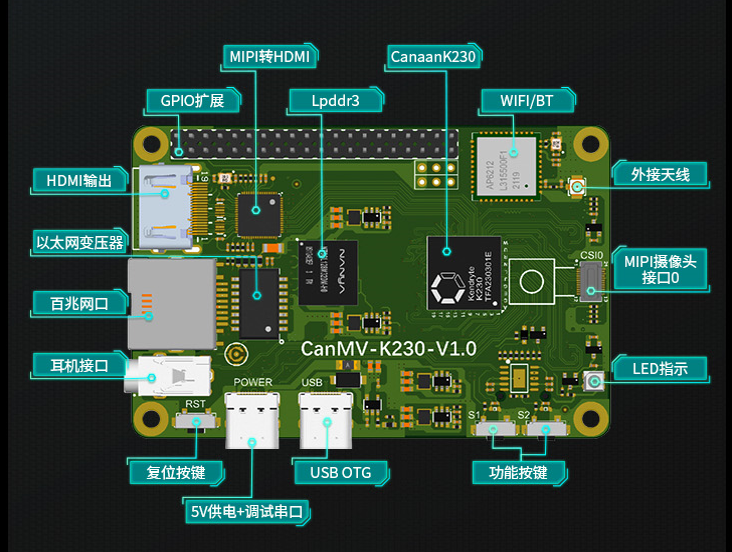
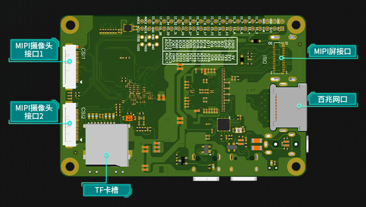
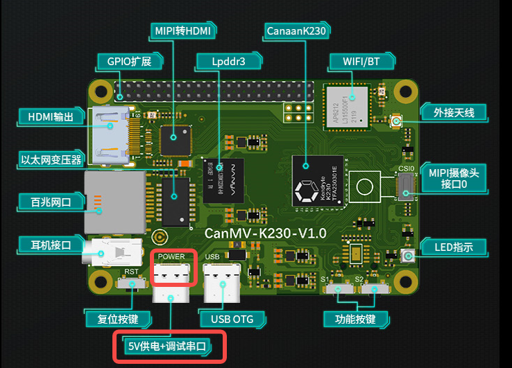
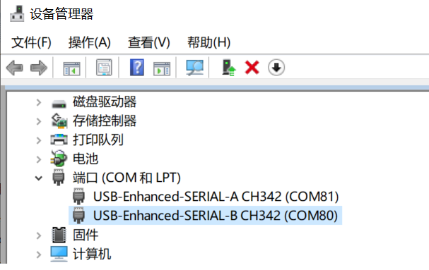
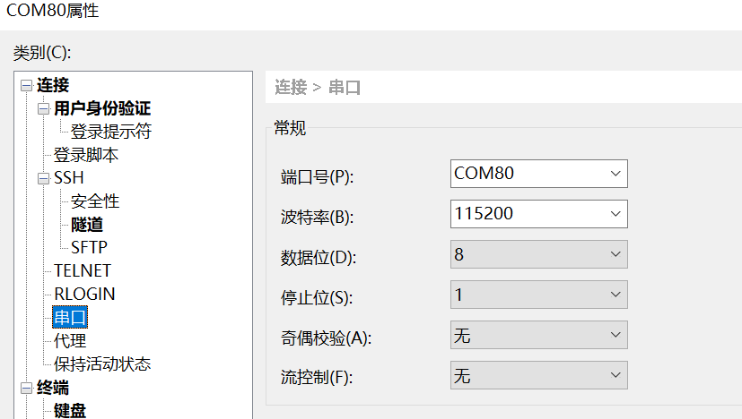
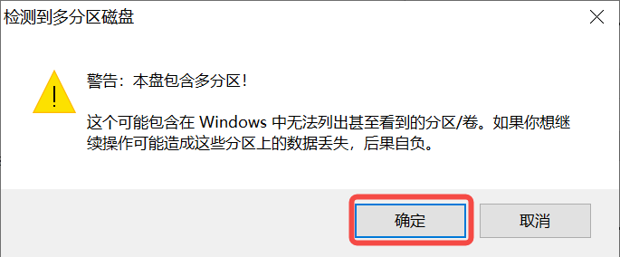
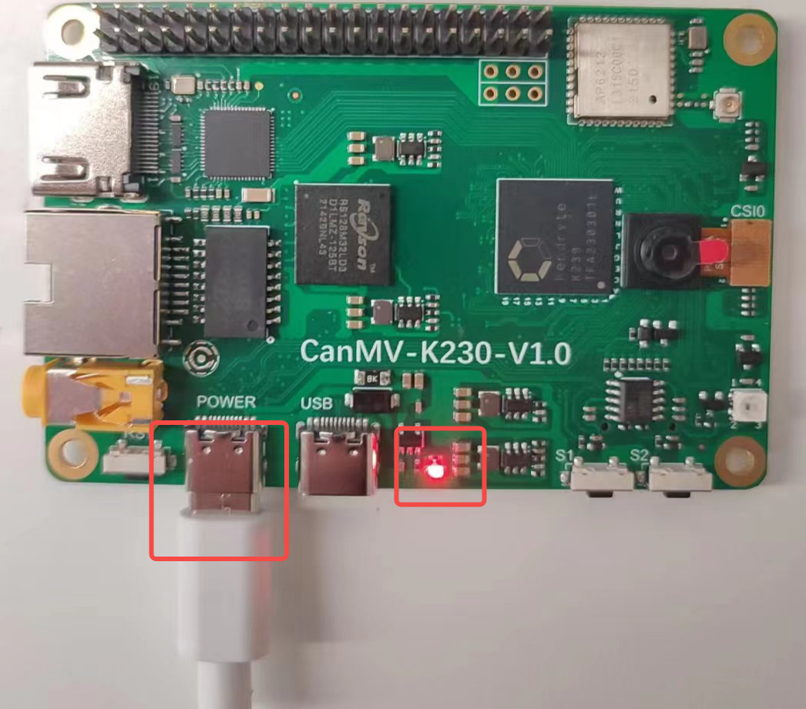
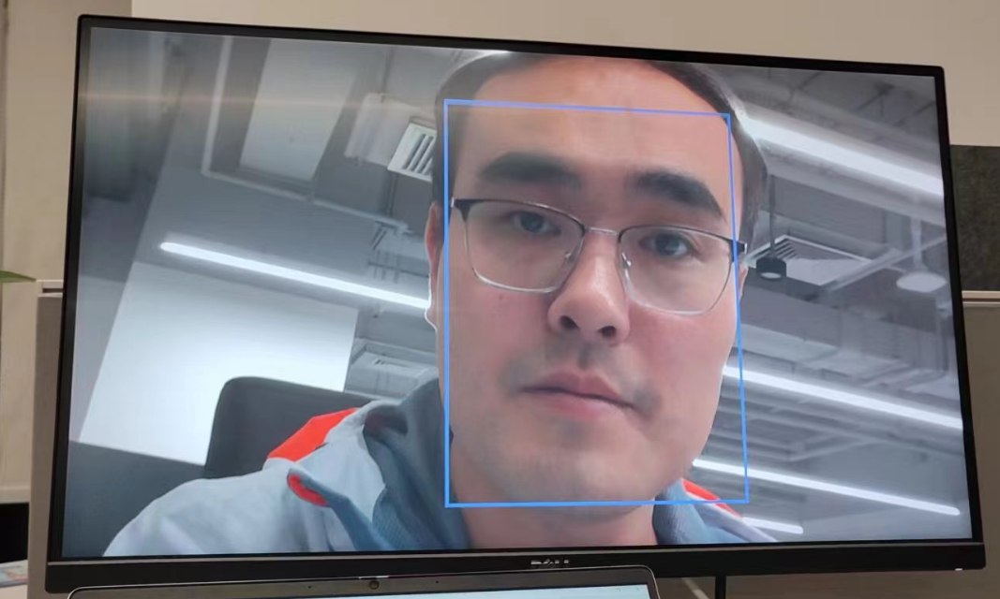

# CanMV-K230 Quick Start Guide

Copyright©2023 Beijing Canaan Creative Information Technology Co., Ltd.

## Disclaimer

The products, services, or features you purchase are subject to the commercial contracts and terms of Beijing Canaan Creative Information Technology Co., Ltd. ("the Company") and its affiliates. All or part of the products, services, or features described in this document may not be within the scope of your purchase or use. Unless otherwise agreed in the contract, the Company does not provide any express or implied statements or warranties regarding the correctness, reliability, completeness, merchantability, fitness for a particular purpose, and non-infringement of any representations, information, or content in this document. Unless otherwise agreed, this document is for reference only as a usage guide.

Due to product version upgrades or other reasons, the content of this document may be updated or modified periodically without any notice.

## Trademark Statement

, "Canaan," and other Canaan trademarks are trademarks of Beijing Canaan Creative Information Technology Co., Ltd. and its affiliates. All other trademarks or registered trademarks mentioned in this document are owned by their respective owners.

**Copyright © 2023 Beijing Canaan Creative Information Technology Co., Ltd. All rights reserved.**
Without the written permission of the Company, no unit or individual is allowed to excerpt, copy, or disseminate any part or all of the content of this document in any form.

## Table of Contents

[TOC]

## 1. Overview of the Development Board

The CanMV-K230 development board uses the latest generation SoC chip K230 from the Kendryte® series AIoT chips of Canaan Technology. This chip adopts a new multi-heterogeneous unit accelerated computing architecture, integrates 2 RISC-V high-efficiency computing cores, and has a built-in new generation KPU (Knowledge Process Unit) intelligent computing unit. It supports multi-precision AI computing power and widely supports general AI computing frameworks, with the utilization rate of some typical networks exceeding 70%.

The chip also features a rich variety of peripheral interfaces, as well as multiple specialized hardware acceleration units for scalar, vector, and graphics processing, such as 2D and 2.5D, capable of full-process acceleration for various image, video, audio, and AI computing tasks. It has characteristics such as low latency, high performance, low power consumption, fast startup, and high security.

The CanMV-K230 adopts a single-board design with rich expansion interfaces, greatly leveraging the high performance of the K230, and can be directly used for the development of various intelligent products, accelerating product deployment.

## 2. CanMV-K230 Default Kit

The default kit of the CanMV-K230 development board includes the following items:

1. CanMV-K230 main board x 1
1. OV5647 camera x 1
1. Type-C data cable x 1

Additionally, users need to prepare the following accessories:

1. TF card, for flashing firmware and booting the system (mandatory)
1. Monitor with HDMI interface and HDMI cable
1. 100M/1000M Ethernet cable, and wired router

## 3. Debugging Instructions

### 3.1 Serial Connection

Connect the CanMV-K230 to the computer using a Type-C cable at the position shown in the figure below.

### 3.2 Serial Debugging

#### 3.2.1 Windows

Install the driver

The CanMV-K230 comes with a USB to serial chip CH342. The driver download address is <https://www.wch.cn/downloads/CH343SER_EXE.html>.

Check the serial port number

Two serial ports are displayed here. COM80 is the debug serial port for the small-core Linux, and COM81 is the debug serial port for the large-core rt-smart.

Configure the serial port information

Open the Xshell tool (or other serial tools).

1. Select the port number displayed in the device manager
1. Baud rate 115200
1. Data bits 8
1. Stop bits 1
1. Parity None
1. Flow control None

#### 3.2.2 Linux

The Linux serial port display is as follows:

- `/dev/ttyACM0` is the debug serial port for the small-core Linux
- `/dev/ttyACM1` is the debug serial port for the large-core rt-smart

You can use Linux's minicom or other serial tools for connection and debugging. The serial port configuration information is the same as in Windows.

## 4. Firmware Acquisition and Flashing

### 4.1 Firmware Acquisition

CanMV-K230 firmware download address: `https://kendryte-download.canaan-creative.com/developer/k230`

For CanMV-K230-V1.0/V1.1, download the gz package starting with "k230_canmv_sdcard", and extract the sysimage-sdcard.img file, which is the firmware for CanMV-K230-V1.0/V1.1.

`For CanMV-K230-V2.0, download the package starting with k230_canmv_v2.`

`Note: Do not flash the gz package (CanMV-K230-V1.0/V1.1 image) starting with k230_canmv_sdcard onto the 2.0 board, as it may damage the board.`

### 4.2 Firmware Flashing

Flash the firmware to the TF card via the computer.

#### 4.2.1 Flashing on Linux

Before inserting the TF card into the host machine, input:

`ls -l /dev/sd\*`

to check the current storage devices.

After inserting the TF card into the host machine, input again:

`ls -l /dev/sd\*`

to check the storage devices at this time. The newly added one is the TF card device node.

Assuming `/dev/sdc` is the TF card device node, execute the following command to flash the TF card:

`sudo dd if=sysimage-sdcard.img of=/dev/sdc bs=1M oflag=sync`

#### 4.2.2 Flashing on Windows

On Windows, you can use the Rufus tool to flash the TF card (Rufus tool download address `http://rufus.ie/downloads/`).

1) Insert the TF card into the PC, then start the Rufus tool, click the "Select" button on the tool interface, and select the firmware to be flashed.

1) Click the "Start" button to start flashing. The flashing process will display a progress bar, and it will prompt "Ready" when the flashing is completed.

## 5. Boot the System

Insert the TF card with the flashed firmware into the CanMV-K230 TF card slot, connect the Type-C cable to the computer and the POWER port on the board, and the board will power on and the system will start.

If the red light in the red box is on, it means the development board is powered on normally. At this point, check the serial port information.

After the system starts, it will run the face detection program by default. Point the camera at a face, and the face will be framed on the monitor.

