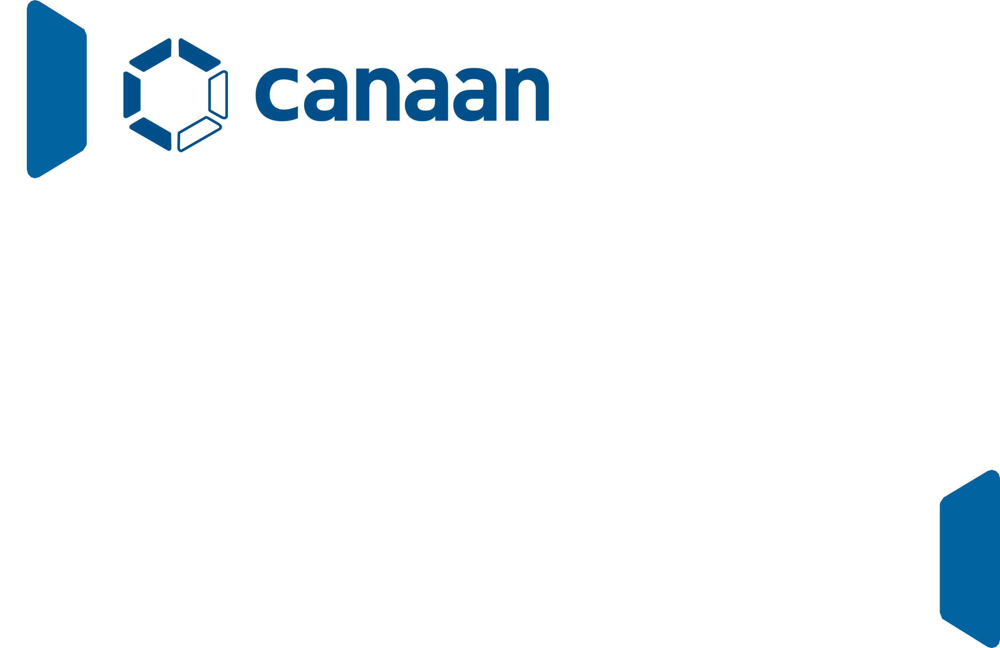
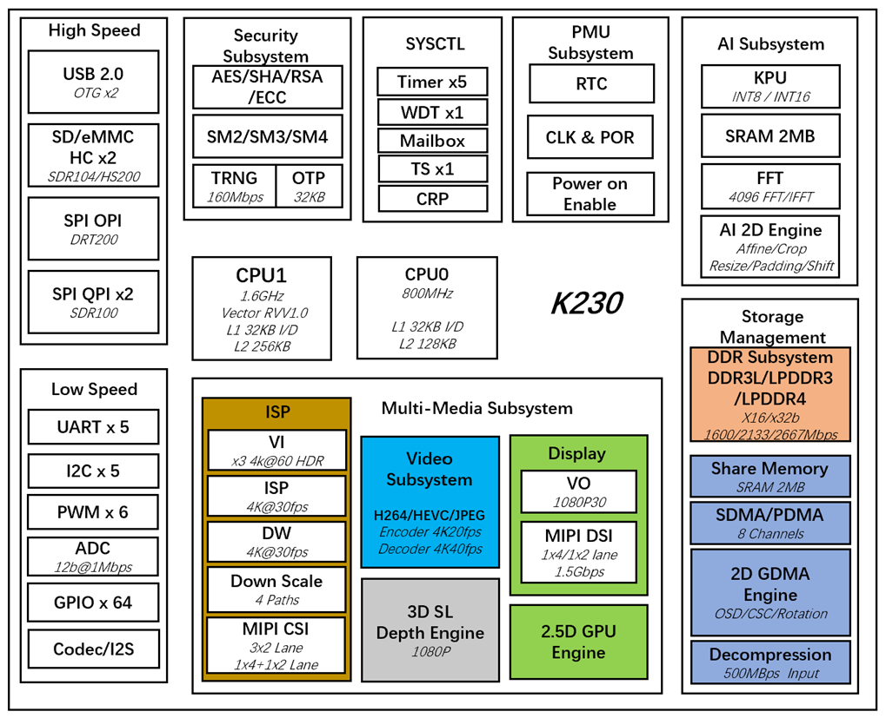
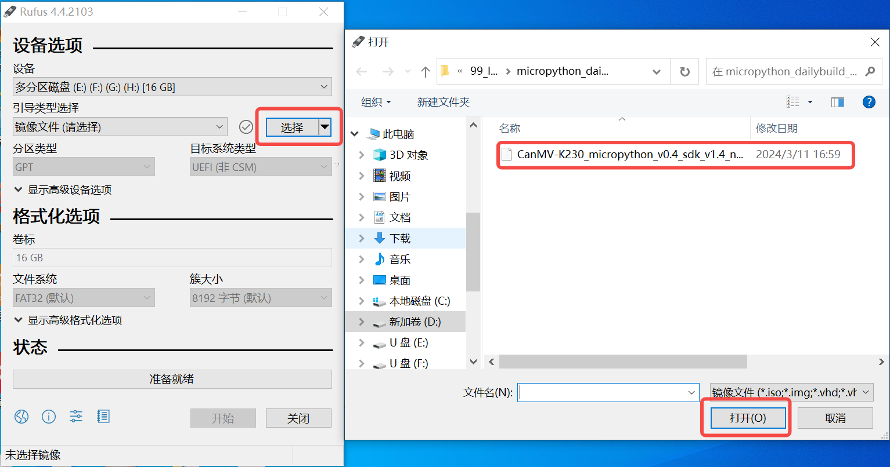
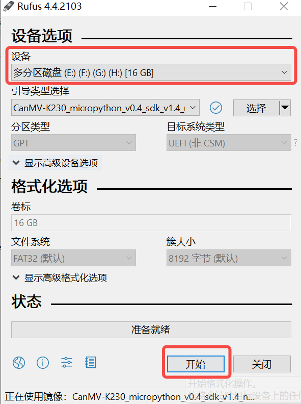
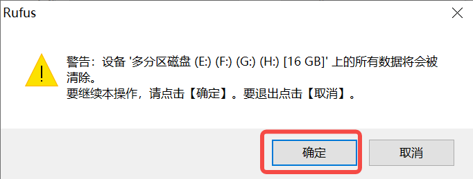
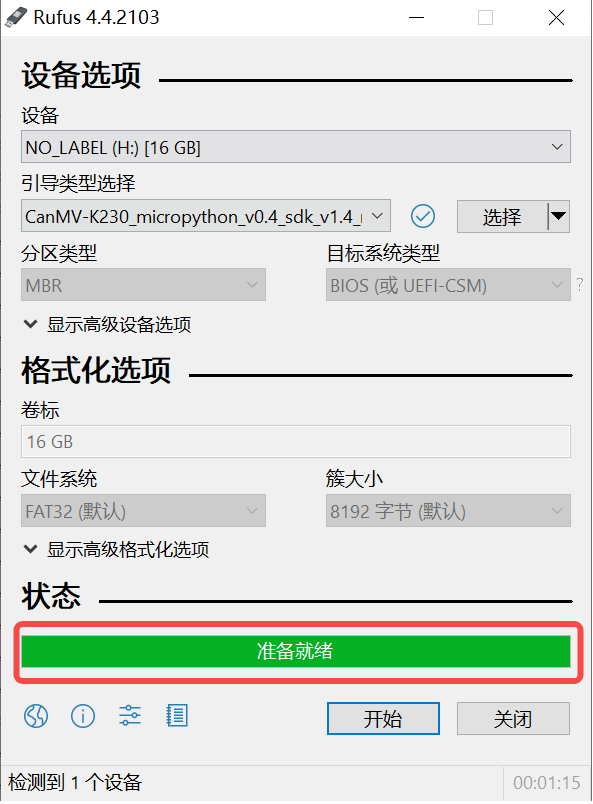
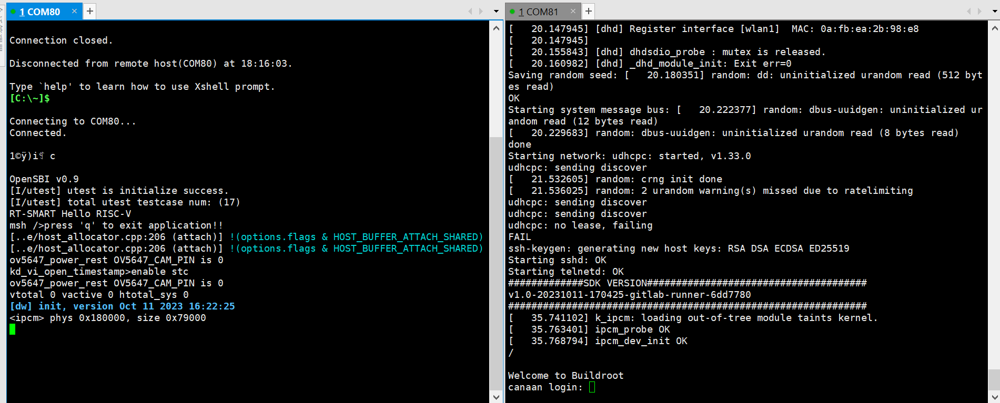

# CanMV-K230 Quick Start Guide

© 2023 Beijing Canaan Creative Information Technology Co., Ltd. All rights reserved.

## Disclaimer

Products, services, or features you purchase are subject to the business contracts and terms of Beijing Canaan Creative Information Technology Co., Ltd. ("our company", hereinafter). All or part of the products, services or features described in this document may not be within your scope of purchase or usage. Unless otherwise agreed in the contract, our company does not make any express or implied representations or warranties as to the accuracy, reliability, completeness, merchantability, fitness for a particular purpose, and non-infringement of any statements, information, or content in this document. Unless otherwise agreed, this document is for reference purposes only.

Due to product version upgrades or other reasons, the content of this document may be updated or modified periodically without any notice.

## Trademark Statement

, "Canaan" and other Canaan trademarks are the property of Beijing Canaan Creative Information Technology Co., Ltd. and its affiliates. All other trademarks or registered trademarks mentioned in this document are owned by their respective holders.

**© 2023 Beijing Canaan Creative Information Technology Co., Ltd. All rights reserved.**
No part of this document may be excerpted, reproduced, or transmitted in any form or by any means without the written permission of our company.

## Table of Contents

[TOC]

## 1. Development Board Overview

The CanMV-K230 development board utilizes the latest generation SoC chip K230 from Canaan Technology’s Kendryte® series AIoT chips. This chip adopts a new multi-heterogeneous unit accelerated computing architecture, integrating two high-efficiency RISC-V computing cores, with a new generation KPU (Knowledge Processor Unit) intelligent computing unit built-in. It possesses multi-precision AI computing power, widely supports general AI computing frameworks, and the utilization rate of some typical networks exceeds 70%.

The chip also features various peripheral interfaces and multiple scalar, vector, graphic, and other dedicated hardware acceleration units for multiple image, video, audio, AI and other diverse computation tasks. It offers low latency, high performance, low power consumption, quick startup, and high security, among many other features.

The CanMV-K230 adopts a single board design with abundant expansion interfaces, maximizing the high-performance advantages of the K230 and can be directly used for the development of various intelligent products, accelerating product landing.

## 2. CanMV-K230 Default Kit

The CanMV-K230 development board default kit includes the following items:

1. CanMV-K230 main board x 1
1. OV5647 camera x 1
1. Type-C data cable x 1

Additionally, the user needs to prepare the following accessories:

1. TF card, used for flashing firmware and booting the system (mandatory)
1. Monitor with HDMI interface and HDMI cable
1. 100M/1000M Ethernet cable and wired router

## 3. Debugging Instructions

### 3.1 Serial Connection

Connect the CanMV-K230 as shown in the picture below using a Type-C cable, with the other end connected to a computer.

### 3.2 Serial Debugging

#### 3.2.1 Windows

Install the Driver

The CanMV-K230 comes with a USB-to-serial chip CH342, driver download link: <https://www.wch.cn/downloads/CH343SER_EXE.html>.

Find the Serial Port Number

Two serial ports are displayed here: COM80 is the debug serial port for the small core Linux, and COM81 is the debug serial port for the big core RT-Smart.

Configure the Serial Port Information

Open the Xshell tool (other serial tools can also be used).

1. Select the port number displayed in the Device Manager
1. Baud rate: 115200
1. Data bits: 8
1. Stop bits: 1
1. Parity: None
1. Flow control: None

#### 3.2.2 Linux

The serial port display in Linux is as follows:

- `/dev/ttyACM0` is the small core Linux debug serial port
- `/dev/ttyACM1` is the big core RT-Smart debug serial port

You can use minicom or other serial tools in Linux for connection and debugging. The serial port configuration is the same as in Windows.

## 4. Firmware Acquisition and Flashing

### 4.1 Firmware Acquisition

CanMV-K230 firmware download link: `https://kendryte-download.canaan-creative.com/developer/k230`

For CanMV-K230 V1.0/V1.1, download the “k230_canmv_sdcard” prefixed compressed package and extract the sysimage-sdcard.img file. This is the firmware for CanMV-K230-V1.0/V1.1.

`For CanMV-K230-V2.0, download the "k230_canmv_v2" prefixed package.`

`Note: Do not flash the "k230_canmv_sdcard...gz" (CanMV-K230-V1.0/V1.1 image) compressed package to a 2.0 board, as it may damage the board.`

### 4.2 Flashing the Firmware

Flash the firmware to the TF card through a computer.

#### 4.2.1 Flashing on Linux

Before inserting the TF card into the host, run:

`ls -l /dev/sd\*`

to check the current storage devices.

After inserting the TF card into the host, run:

`ls -l /dev/sd\*`

to check the storage devices again. The newly added one is the TF card device node.

Assuming /dev/sdc is the TF card device node, run the following command to flash the TF card:

`sudo dd if=sysimage-sdcard.img of=/dev/sdc bs=1M oflag=sync`

#### 4.2.2 Flashing on Windows

In Windows, you can flash the TF card using the Rufus tool (Rufus tool download link: `http://rufus.ie/downloads/`).

1. Insert the TF card into the PC, then start the Rufus tool and click the "Select" button on the tool interface to choose the firmware to be flashed.

1. Click the "Start" button to start flashing. There will be a progress bar displayed during the flashing process. Once finished, a "Ready" prompt will be shown.

## 5. Booting the System

Insert the TF card with the flashed firmware into the CanMV-K230 TF card slot. Connect the Type-C cable to both the computer and the POWER port on the board. The board will power on and the system will start booting.

If the red light in the red box is on, it indicates that the development board is powered on correctly. At this time, check the serial information.

After the system starts, it will run the face detection program by default. Point the camera at a face, and it will frame the face on the monitor screen.

