# CanMV K230 Tutorial


Copyright 2023 Canaan Inc. ©

<div style="page-break-after:always"></div>

## Disclaimer

The products, services or features you purchase should be subject to Canaan Inc. ("Company", hereinafter referred to as "Company") and its affiliates are bound by the commercial contracts and terms and conditions of all or part of the products, services or features described in this document may not be covered by your purchase or use. Unless otherwise agreed in the contract, the Company does not provide any express or implied representations or warranties as to the correctness, reliability, completeness, merchantability, fitness for a particular purpose and non-infringement of any statements, information, or content in this document. Unless otherwise agreed, this document is intended as a guide for use only.

Due to product version upgrades or other reasons, the content of this document may be updated or modified from time to time without any notice.

## Trademark Notice

, "Canaan" and other Canaan trademarks are trademarks of Canaan Inc. and its affiliates. All other trademarks or registered trademarks that may be mentioned in this document are owned by their respective owners.

**Copyright 2023 Canaan Inc.. © All Rights Reserved.**
Without the written permission of the company, no unit or individual may extract or copy part or all of the content of this document without authorization, and shall not disseminate it in any form.

<div style="page-break-after:always"></div>

## Directory

[toc]

## preface

Based on the CanMV-K230 development board, this article introduces the development process of the K230 SDK, nncase, and AI.

## Get started quickly

### Overview of the development board

The CanMV-K230 development board uses the latest generation of SoC chip K230 in the Canaan Kendryte® series AIoT chips. The chip adopts a new multi-heterogeneous unit accelerated computing architecture, integrates 2 RISC-V energy-efficient computing cores, built-in a new generation of KPU (Knowledge Process Unit) intelligent computing unit, has multi-precision AI computing power, widely supports common AI computing frameworks, and the utilization rate of some typical networks exceeds 70%.

The chip also has a variety of peripheral interfaces, as well as 2D, 2.5D and other scalar, vector, graphics and other special hardware acceleration units, which can accelerate the whole process of computing and acceleration of a variety of diverse computing tasks such as image, video, audio, and AI, and has many characteristics such as low latency, high performance, low power consumption, fast startup, and high security.

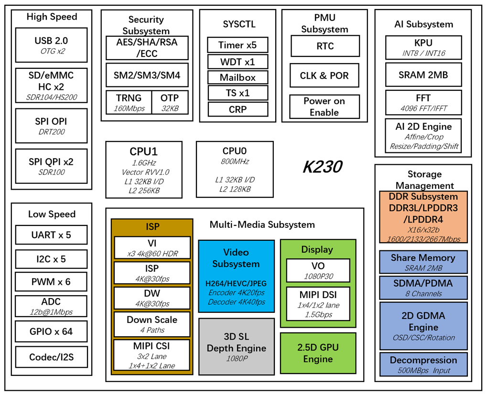

CanMV-K230 adopts a single board design and rich expansion interfaces, which greatly exerts the advantages of K230's high performance, and can be directly used in the development of various intelligent products to accelerate product landing.

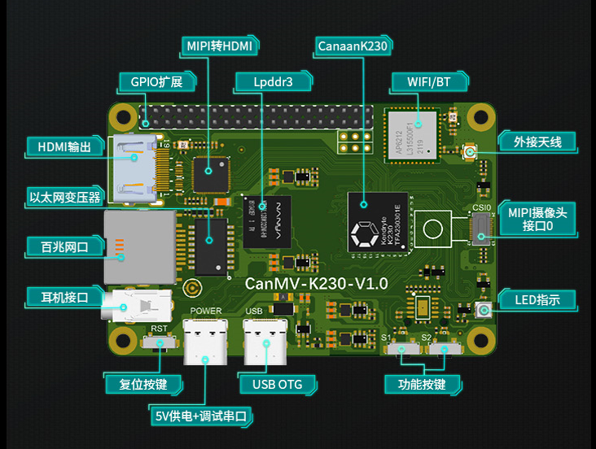
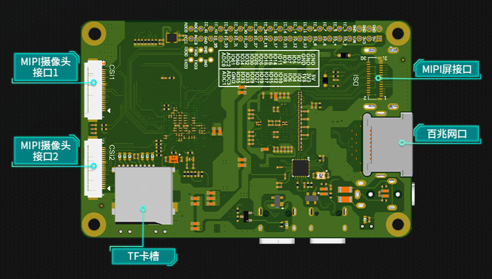

### CanMV-K230 default kit

The CanMV-K230 board default kit contains the following items:

1 CanMV-K230 motherboard x 1

2 OV5647 camera x 1

3 Type-C data cable x 1

In addition, the user needs to prepare the following accessories:

1 TF card, used to flash firmware, boot system (required)

2 Display with HDMI interface and HDMI cable, the display must support 1080P30, otherwise it cannot be displayed

3 100M/1000M Ethernet cable, and wired router

### Debugging instructions

#### Serial port connection

Use the Type-C cable to connect the CanMV-K230 to the position shown below, and connect the other end of the cable to the computer.

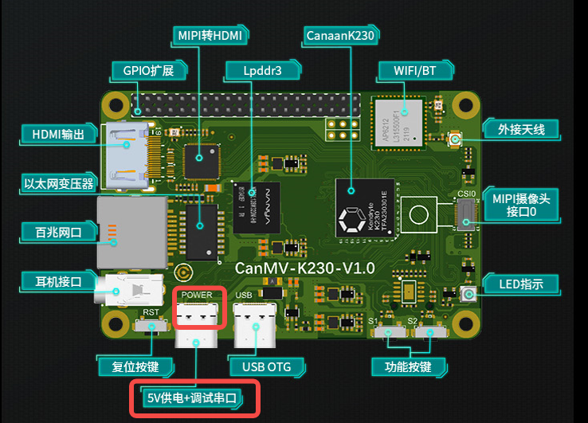

#### Serial port debugging

##### Windows

Install the driver

CanMV-K230 comes with USB to serial port chip CH342, driver download address<https://www.wch.cn/downloads/CH343SER_EXE.html>.

Check the serial port number

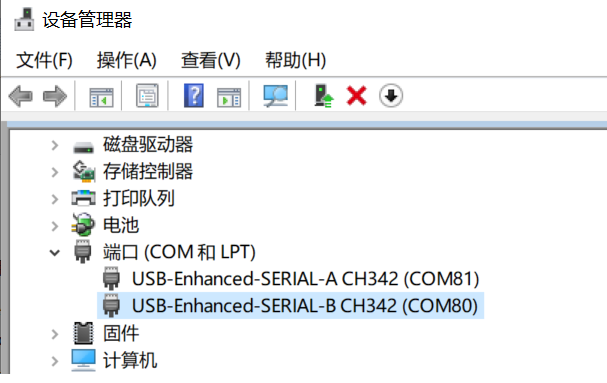

Two serial ports are shown here, COM80 is the debugging serial port of small-core Linux, and COM81 is the debugging serial port of large-core rt-smart.

Configure serial port information

Open the tool Xshell (you can also use other serial port tools).

1 Port number: Select the port number displayed by Device Manager

2 Baud rate 115200

3 Data bit 8

4 Stop bit 1

5 Not Parity test

6 Not Flow control

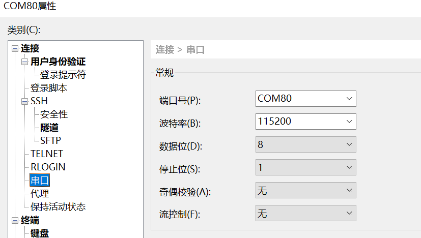

##### linux

The Linux serial port is displayed as follows:

- `/dev/ttyACM0`Debug the serial port for small-core Linux
- `/dev/ttyACM1`Debug the serial port for the large-core RT-SMART

You can use Linux minicom or other serial port tools for connection debugging, and the serial port configuration information is consistent with Windows.

### Firmware acquisition and flashing

#### Firmware acquisition

CanMV-K230 firmware download address: <https://kendryte-download.canaan-creative.com/developer/k230>

Please download the gz archive starting with "k230_canmv" and extract the sysimage-sdcard.img file, which is the firmware of CanMV-K230.

#### Firmware flashing

Flash the firmware to the TF card through the computer.

##### Burning under Linux

Before inserting the TF card into the host, enter:

`ls -l /dev/sd\*`

View the current storage device.

After inserting the TF card into the host, enter again:

`ls -l /dev/sd\*`

Looking at the storage device at this time, the new addition is the TF card device node.

Assume that /dev/sdc is the TF card device node, run the following command to flash the TF card:

`sudo dd if=sysimage-sdcard.img of=/dev/sdc bs=1M oflag=sync`

##### Flashing under Windows

TF card can be burned through the balena Etcher tool under Windows (balena Etcher tool download address<https://www.balena.io/etcher/>).

1) Insert the TF card into the PC, then launch the balena Etcher tool, click the "Flash from file" button on the tool interface, and select the firmware to be programmed.

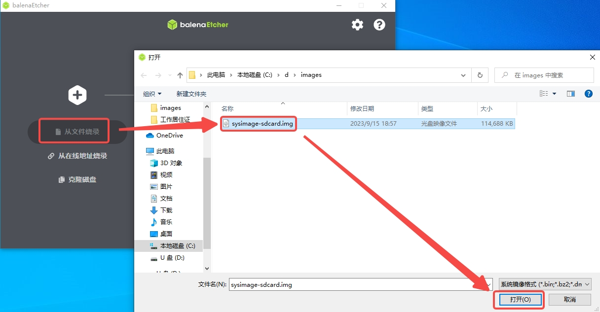

1) Click the "Select target" button on the tool interface to select the target sdcard card.

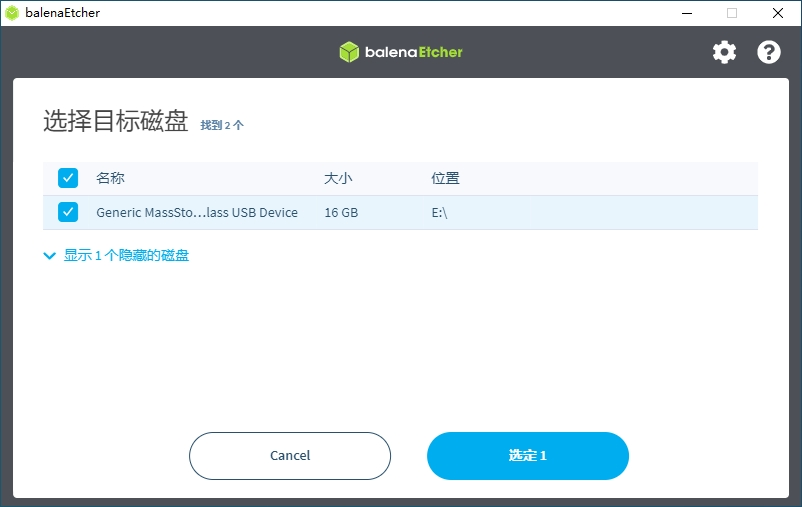

1) Click the "Flash" button to start flashing, the flashing process has a progress bar display, and Flash Finish will be prompted after flashing.

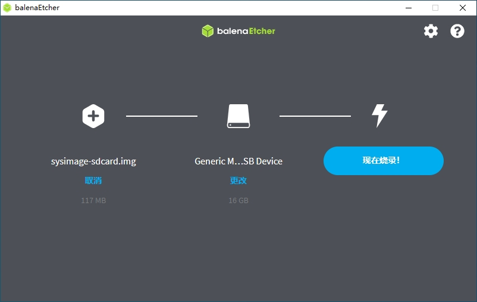
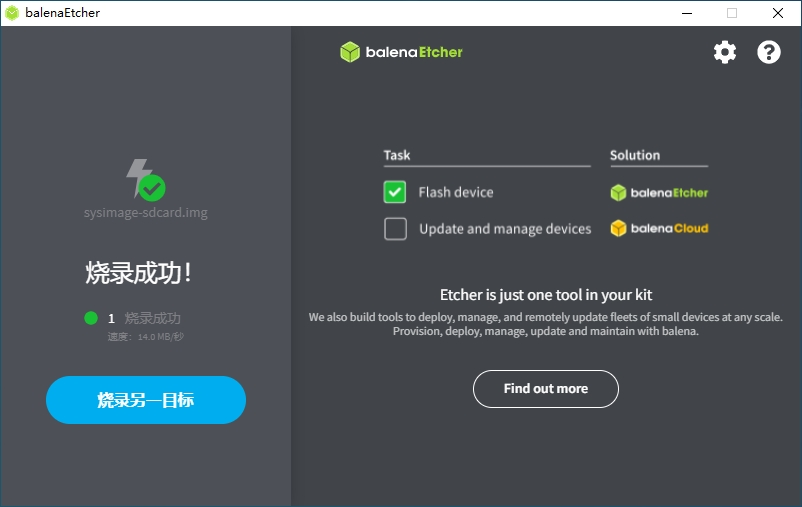

### Start the system

Insert the TF card with burned firmware into the CanMV-K230 TF card slot, connect the Type-C cable to the POWER port at the computer and the board end, the board will be powered on, and the system will start to start.
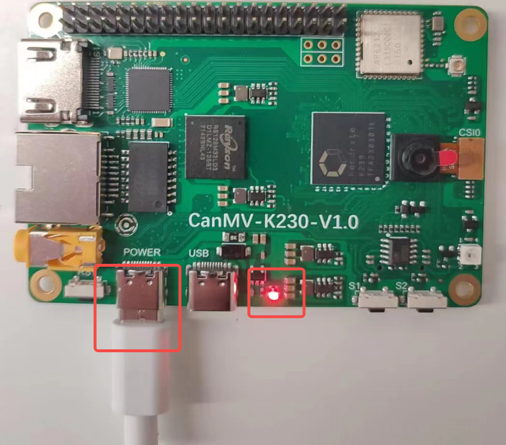

If the red light in the red frame is on, it means that the board is powered up normally. View the serial port information at this time.

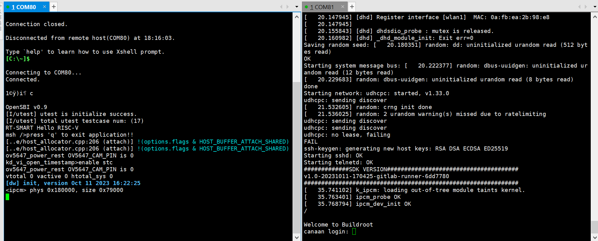

After the system starts, the face detection program is run by default, the camera is pointed at the face, and the face will be framed on the monitor.

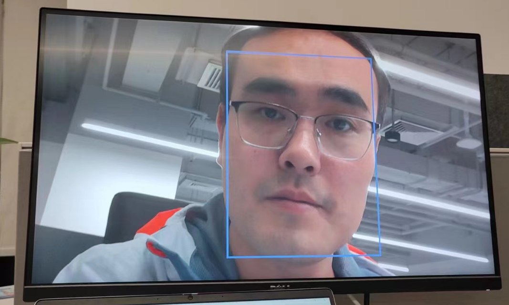

## Linux + RT-smart dual system development

This section describes how to use the K230 SDK for Linux and RT-smart system development. The K230 SDK includes the source code, toolchain and other related resources needed for development of heterogeneous systems based on Linux and RT-smart dual-core.

### Development environment setup

#### Compile the environment

| Host environment                    | description                                                 |
|-----------------------------|------------------------------------------------------|
| Docker compilation environment              | The SDK provides a docker file, which can generate docker images for compiling the SDK |
| Ubuntu 20.04.4 LTS (x86_64) | The SDK can be compiled in the ubuntu 20.04 environment                      |

The K230 SDK needs to be compiled in the Linux environment, the SDK supports docker environment compilation, and the docker file() is released in the SDK development package,`tools/docker/Dockerfile` which can generate docker images. The specific dockerfile usage and compilation steps will be described in detail in the compilation section below.

The Docker image used by the SDK is based on ubuntu 20.04, if you do not use the docker compilation environment, you can refer to the content of dockerfile in the ubuntu 20.04 host environment, install the relevant HOST package and toolchain, and compile the SDK.

The K230 SDK has not been verified in the host environment of other Linux versions, and there is no guarantee that the SDK can be compiled in other environments.

#### SDK development kit acquisition

The SDK is currently released simultaneously on GitHub and GitHub

<https://github.com/kendryte/k230_sdk>

<https://gitee.com/kendryte/k230_sdk>

Users can download the archive directly, download it at [GitHub or](https://github.com/kendryte/k230_sdk/releases)GitHub[, or use](https://gitee.com/kendryte/k230_sdk/releases) or `git clone https://github.com/kendryte/k230_sdk``git clone https://gitee.com/kendryte/k230_sdk.git`

Users can choose to use GitHub or GitHub according to their network conditions.

### SDK compilation

#### Compile the introduction

The K230 SDK supports one-click compilation of large and little core operating systems and common components, and generates image files that can be programmed for deployment to the development board and start running. The username of the Linux system on the device is root without password;

Setp 1: Refer to the above to get the SDK development package

Step 2: Enter the SDK root directory

`cd k230_sdk`

Step 3: Download toolchain

`source tools/get_download_url.sh && make prepare_sourcecode`

>`make prepare_sourcecode` will download both Linux and RT-Smart toolchain, buildroot package and AI package from Microsoft Azure cloud server with CDN, the download cost time may based on your network connection speed.

Step 4: Generate a docker image (required for the first compilation, skip this step after you have generated a docker image)

`docker build -f tools/docker/Dockerfile -t k230_docker tools/docker`

Step 5: Enter the docker environment,

`docker run -u root -it -v $(pwd):$(pwd) -v $(pwd)/toolchain:/opt/toolchain -w $(pwd) k230_docker /bin/bash`

Step 6: Run the following command in the Docker environment to compile the SDK

make CONF=k230_canmv_defconfig #编译CanMV-K230 board image

The SDK does not support multi-process compilation, do not add multi-process compilation parameters like -j32.

#### Compile the output artifacts

After the compilation is complete, you `output/k230_canmv_defconfig/images`can see the compilation output in the directory

`images`The image files in the directory are described as follows:

`sysimage-sdcard.img` ------------- is the boot image of the TF card;

`sysimage-sdcard.img.gz` --------- is the boot image compressed package of the TF card (gzip archive of sysimage-sdcard.img file), which needs to be decompressed first when burning.

At this point, the entire SDK is compiled, and the adult image sysimage-sdcard.img can be flashed to the TF card to boot the system.

#### example

For basic hello world, please refer to [K230_ Practical Basics _hello_world](https://github.com/kendryte/k230_docs/blob/main/zh/02_applications/tutorials/K230_%E5%AE%9E%E6%88%98%E5%9F%BA%E7%A1%80%E7%AF%87_hello_world.md)

In the case of Vicap_demo, the code is located at k230_sdk/src/big/mpp/userapps/sample/sample_vicap

VICAP Demo implements the camera data acquisition preview function by calling the MPI interface. The CanMV development board uses the OV5647 camera module by default, which supports up to three data streams for a single camera.

##### compile

Execute make rt-smart-clean && rt-smart && make build-image in the k230_sdk directory, compile the changes of the big core into the sd card image, and generate the image file sysimage-sdcard.img in the k230_sdk/output/k230_evb_defconfig/images/ directory

The corresponding program is located at k230_sdk/src/big/mpp/userapps/sample/elf/sample_vicap.elf

##### execute

The big kernel end enters /sharefs/app and executes commands in this directory`./sample_vicap` to obtain command help information
When you enter`sample_vicap` the : command, print the following prompt:

```shell
usage: ./sample_vicap -mode 0 -dev 0 -sensor 0 -chn 0 -chn 1 -ow 640 -oh 480 -preview 1 -rotation 1
Options:
 -mode:         vicap work mode[0: online mode, 1: offline mode. only offline mode support multiple sensor input]     default 0
 -dev:          vicap device id[0,1,2]        default 0
 -dw:           enable dewarp[0,1]    default 0
 -sensor:       sensor type[0: ov9732@1280x720, 1: ov9286_ir@1280x720], 2: ov9286_speckle@1280x720]
 -ae:           ae status[0: disable AE, 1: enable AE]        default enable
 -awb:          awb status[0: disable AWB, 1: enable AWb]     default enable
 -chn:          vicap output channel id[0,1,2]        default 0
 -ow:           the output image width, default same with input width
 -oh:           the output image height, default same with input height
 -ox:           the output image start position of x
 -oy:           the output image start position of y
 -crop:         crop enable[0: disable, 1: enable]
 -ofmt:         the output pixel format[0: yuv, 1: rgb888, 2: rgb888p, 3: raw], only channel 0 support raw data, default yuv
 -preview:      the output preview enable[0: disable, 1: enable], only support 2 output channel preview
 -rotation:     display rotaion[0: degree 0, 1: degree 90, 2: degree 270, 3: degree 180, 4: unsupport rotaion]
 -help:         print this help
```

The parameters are described as follows:

| **Parameter name** | **Optional parameter value** | **Parameter description** |
|---|---|---|
| -Dev         | 0: vicap device 0 1: vicap device 1 2: vicap device 2.                             | Specify the currently used vicap device, and the system supports up to three vicap devices. By specifying the device number, the binding relationship between the sensor and different vicap devices is realized. For example: -dev 1 -sensor 0 binds the ov9732 1280x720 RGB image output to vicap device 1.                   |
| -mode | 0: Online mode; 1: Offline mode | Specify the vicap device working mode, current before online mode and offline mode. For multiple sensor inputs, it must be specified as offline mode. |
| -sensor      | 23: OV5647 (CanMV development board only supports this sensor) | Specifies the type of sensor currently in use                                                         |
| -Chn         | 0: vicap device output channel 0 1: vicap device output channel 1 2: vicap device output channel 2.     | Specify the output channel of the currently used vicap device, one vicap device supports up to three outputs, and only channel 0 supports RAW image format output  |
| -ow          |                                                                         | Specifies the output image width, which defaults to the input image width. The width needs to be 16 bytes aligned. If the default width exceeds the maximum width of the display output, the display output width is used as the final output width of the image If the output width is smaller than the input image width and the ox or oy parameters are not specified, the default is the scaled output |
| -oh          |                                                                         | Specifies the output image height, which defaults to the input image height. If the default height exceeds the maximum height of the display output, the display output height is used as the final output height of the image If the output height is less than the input image height and the ox or oy parameter is not specified, the default is the scaled output  |
| -ox          |                                                                         | Specifies the horizontal start position of the image output, this parameter greater than 0 will perform the output cropping operation  |
| -Limited liability company          |                                                                         | Specifies the vertical start position of the image output, this parameter greater than 0 will perform the output cropping operation |
| -crop        | 0: Disable the cropping function 1: Enable the cropping function                                         | When the output image size is smaller than the input image size, the output is not scaled by default, or clipped if the flag is specified  |
| -ofmt        | 0:YUV format output 1:RGB format output 2:RAW format output                            | Specify the output image format, the default is YUV output.  |
| -preview     | 0: Disable preview display 1: Enable preview display                                         | Specifies the output image preview display function. The default is enabled. Currently, up to 2 output images can be previewed at the same time. |
| -rotation    | 0: Rotate 0 degrees 1: Rotate 90 degrees 2: Rotate 180 degrees 3: Rotate 270 degrees 4: Rotation is not supported          | Specifies the rotation angle of the preview display window. By default, only the first output image window supports the rotation function. |

Example 1:

`./sample_vicap -dev 0 -sensor 23 -chn 0 -chn 1 -ow 640 -oh 480`

Note: Bind the ov5647@1920x1080 RGB output to vicap device 0 and enable vicap device output channel 0 and channel 1, where channel 0 output size defaults to the input image size (1920x1080) and channel 1 output image size is 640x480

For the API used in this example, refer to [K230_VICAP_API Reference.md](https://github.com/kendryte/k230_docs/blob/main/zh/01_software/board/mpp/K230_VICAP_API%E5%8F%82%E8%80%83.md) [K230_Video Output _API Reference.md](https://github.com/kendryte/k230_docs/blob/main/zh/01_software/board/mpp/K230_%E8%A7%86%E9%A2%91%E8%BE%93%E5%87%BA_API%E5%8F%82%E8%80%83.md)

For other demos supported by the CanMV-K230 development board, please refer to [the K230_SDK_CanMV_Board_Demo User Guide](https://github.com/kendryte/k230_docs/blob/main/zh/01_software/board/examples/K230_SDK_CanMV_Board_Demo%E4%BD%BF%E7%94%A8%E6%8C%87%E5%8D%97.md)

For other SDK-related documents, please visit [the K230 SDK documentation](https://github.com/kendryte/k230_docs)

## Developed by nncase

`nncase` is a neural network compiler for AI accelerators, which is used to generate model files, `.kmodel`, required for inference for `Kendryte` series chips and provide `runtime lib`.

This tutorial mainly includes the following:

1. Use `nncase` to compile the model and generate `kmodel`.
1. Inference `kmodel` on PCs and development boards.

> Tips：
>
> 1. This tutorial aims to familiarize users with the process of using nncase, and the input data of the model in this doc are random numbers. For details about the actual application scenario, see the subsequent chapter "AI Development".
> 1. The version of nncase in the official CanMV image may be outdated, if you need to use the latest nncase, you need to update the runtime library and recompile the CanMV image.

### Model compilation and simulator inference

#### Install the nncase toolchain

The nncase toolchain includes both `nncase` and `nncase-kpu` plugin packages, both of which need to be installed correctly to compile the model files supported by CanMV-K230. Both `nncase` and `nncase-kpu` plugin packages are released on [NNcase GitHub Release](https://github.com/kendryte/nncase/releases) and depend on `dotnet-7.0`.

- In `Linux` platform, `nncase` and `nncase-kpu` can be installed directly online by `pip`, and use `apt` to install `dotnet` in the Ubuntu environment.

    ```Shell
    pip install --upgrade pip
    pip install nncase
    pip install nncase-kpu
    
    # nncase-2.x need dotnet-7
    sudo apt-get update
    sudo apt-get install -y dotnet-sdk-7.0
    ```

    >Tips: If you use the official CanMV image, you need to check the version of SDK and nncase.

- **The `Windows` platform only supports `nncase` online installation, and  you need to manually download `nncase-kpu` on [NNcase GitHub Release](https://github.com/kendryte/nncase/releases) and install it.**
- If you do not have an Ubuntu environment, you can use `nncase docker` (Ubuntu 20.04 + Python 3.8 + dotnet-7.0).

    ```Shell
    cd /path/to/nncase_sdk
    docker pull ghcr.io/kendryte/k230_sdk
    docker run -it --rm -v `pwd`:/mnt -w /mnt ghcr.io/kendryte/k230_sdk /bin/bash -c "/  bin/bash"
    ```

    > Tips: Currently only support py3.6-3.10, if pip installation fails, please check the pip version corresponding to Python.

#### Environment configuration

After using pip to install the packages, you need to add the installation path to the PATH environment variable.

```Shell
export PATH=$PATH:/path/to/python/site-packages/
```

#### Original model description

Currently `nncase` supporte `tflite`, `onnx` format models, more formats support is ongoing.

> Tips：
>
> 1. For TensorFlow models, `pb` format, please refer to the official documentation to convert them to the `tflite` model. Be careful not to set quantization options, just export the floating-point model. If `quantize` and `dequantize` operators exist in the model, they belong to quantization models and are currently not supported.
> 1. For PyTorch models, `pth` format, you need to use `torch.export.onnx` to export the `onnx` model.

#### Description of compilation parameters

Before compiling a model, you need to know the following key information:

1. `KPU` uses fixed-point operations when making inferences. Therefore, when compiling the `kmodel`, you must configure quantization-related parameters that are used to convert the `kmodel` from floating point to fixed point. Details in `nncase` documentation [PTQTensorOptions](https://github.com/kendryte/nncase/blob/master/docs/USAGE_v2.md#ptqtensoroptions).
1. `nncase` support for adding preprocessing operations in `kmodel`, which can reduce the preprocessing overhead when inference. The relevant parameters and schematics are found in `nncase` documentation [CompileOptions](https://github.com/kendryte/nncase/blob/master/docs/USAGE_v2.md#compileoptions).

#### Description of compilation script

This [Jupyter notebook](https://github.com/kendryte/nncase/blob/master/examples/user_guide/k230_simulate-ZH.ipynb) describes in detail the process of compiling and infering kmodels using nncase. It contains the following information。

- Parameter configuration: describes how to correctly configure compilation parameters in order to satisfy the demands of actual deployment.
- Obtain model information: explain the method of obtaining key data such as network structure and layer information from the original model.
- Set calibration dataset: explains how to prepare calibration dataset sample data, including single-input and multiple-input models, for quantifying the calibration process.
- Set the inference data format: explains how to configure input data during inference to support different demand scenarios.
- Configure multi-input model: describes how to correctly set the shape, data format and other information of each input when processing multi-input model.
- PC simulator inference: explain how to use the simulator to infer on PC the `kmodel`, which is a key step to verify the compilation effect;
- Compare inference results: verify the correctness of kmodels by comparing inference results with different frameworks (TensorFlow, PyTorch, etc.);

  The above steps systematically introduce the whole process of model compilation and inference, which is suitable for beginners to learn from scratch and can also be used as a reference guide for experienced users.

#### Sample code

When you have read the full tutorial in the Jupyter notebook, you can modify the options based on the following sample code.

```Python
import nncase
import numpy as np
from sklearn.metrics.pairwise import cosine_similarity

import onnx
import onnxsim

def get_cosine(vec1, vec2):
    """
    result compare
    """
    return cosine_similarity(vec1.reshape(1, -1), vec2.reshape(1, -1))


def read_model_file(model_file):
    """
    read model
    """
    with open(model_file, 'rb') as f:
        model_content = f.read()
    return model_content


def parse_model_input_output(model_file):
    """
    parse onnx model
    """
    onnx_model = onnx.load(model_file)
    input_all = [node.name for node in onnx_model.graph.input]
    input_initializer = [node.name for node in onnx_model.graph.initializer]
    input_names = list(set(input_all) - set(input_initializer))
    input_tensors = [
        node for node in onnx_model.graph.input if node.name in input_names]

    # input
    inputs = []
    for _, e in enumerate(input_tensors):
        onnx_type = e.type.tensor_type
        input_dict = {}
        input_dict['name'] = e.name
        input_dict['dtype'] = onnx.mapping.TENSOR_TYPE_TO_NP_TYPE[onnx_type.elem_type]
        input_dict['shape'] = [i.dim_value for i in onnx_type.shape.dim]
        inputs.append(input_dict)

    return onnx_model, inputs

def model_simplify(model_file):
    """
    simplify model
    """
    if model_file.split('.')[-1] == "onnx":
        onnx_model, inputs = parse_model_input_output(model_file)
        onnx_model = onnx.shape_inference.infer_shapes(onnx_model)
        input_shapes = {}
        for input in inputs:
            input_shapes[input['name']] = input['shape']

        onnx_model, check = onnxsim.simplify(onnx_model, input_shapes=input_shapes)
        assert check, "Simplified ONNX model could not be validated"

        model_file = os.path.join(os.path.dirname(model_file), 'simplified.onnx')
        onnx.save_model(onnx_model, model_file)
        print("[ onnx done ]")
    elif model_file.split('.')[-1] == "tflite":
        print("[ tflite skip ]")
    else:
        raise Exception(f"Unsupport type {model_file.split('.')[-1]}")

    return model_file

def run_kmodel(kmodel_path, input_data):
    print("\n---------start run kmodel---------")
    print("Load kmodel...")
    model_sim = nncase.Simulator()
    with open(kmodel_path, 'rb') as f:
        model_sim.load_model(f.read())

    print("Set input data...")
    for i, p_d in enumerate(input_data):
        model_sim.set_input_tensor(i, nncase.RuntimeTensor.from_numpy(p_d))

    print("Run...")
    model_sim.run()

    print("Get output result...")
    all_result = []
    for i in range(model_sim.outputs_size):
        result = model_sim.get_output_tensor(i).to_numpy()
        all_result.append(result)
    print("----------------end-----------------")
    return all_result


def compile_kmodel(model_path, dump_path, calib_data):
    """
    Set compile options and ptq options.
    Compile kmodel.
    Dump the compile-time result to 'compile_options.dump_dir'
    """
    print("\n----------   compile    ----------")
    print("Simplify...")
    model_file = model_simplify(model_path)

    print("Set options...")
    # import_options
    import_options = nncase.ImportOptions()

    ############################################
    # 你需要修改下面这段代码中的参数来适配你的模型。
    ############################################
    # compile_options
    compile_options = nncase.CompileOptions()
    compile_options.target = "k230" #"cpu"
    compile_options.dump_ir = True  # if False, will not dump the compile-time result.
    compile_options.dump_asm = True
    compile_options.dump_dir = dump_path
    compile_options.input_file = ""

    # preprocess args
    compile_options.preprocess = False
    if compile_options.preprocess:
        compile_options.input_type = "uint8" # "uint8" "float32"
        compile_options.input_shape = [1,224,320,3]
        compile_options.input_range = [0,1]
        compile_options.input_layout = "NHWC" # "NHWC"
        compile_options.swapRB = False
        compile_options.mean = [0,0,0]
        compile_options.std = [1,1,1]
        compile_options.letterbox_value = 0
        compile_options.output_layout = "NHWC" # "NHWC"

    # quantize options
    ptq_options = nncase.PTQTensorOptions()
    ptq_options.quant_type = "uint8" # datatype : "float32", "int8", "int16"
    ptq_options.w_quant_type = "uint8"  # datatype : "float32", "int8", "int16"
    ptq_options.calibrate_method = "NoClip" # "Kld"
    ptq_options.finetune_weights_method = "NoFineTuneWeights"
    ptq_options.dump_quant_error = False
    ptq_options.dump_quant_error_symmetric_for_signed = False

    # mix quantize options
    # more details in docs/MixQuant.md
    ptq_options.quant_scheme = ""
    ptq_options.export_quant_scheme = False
    ptq_options.export_weight_range_by_channel = False
    ############################################

    ptq_options.samples_count = len(calib_data[0])
    ptq_options.set_tensor_data(calib_data)

    print("Compiling...")
    compiler = nncase.Compiler(compile_options)
    # import
    model_content = read_model_file(model_file)
    if model_path.split(".")[-1] == "onnx":
        compiler.import_onnx(model_content, import_options)
    elif model_path.split(".")[-1] == "tflite":
        compiler.import_tflite(model_content, import_options)

    compiler.use_ptq(ptq_options)

    # compile
    compiler.compile()
    kmodel = compiler.gencode_tobytes()

    # 可自行修改kmodel_path,在推理时需要传入正确的kmodel_path
    kmodel_path = os.path.join(dump_path, "test.kmodel")
    with open(kmodel_path, 'wb') as f:
        f.write(kmodel)
    print("----------------end-----------------")
    return kmodel_path

if __name__ == "__main__":
    # compile kmodel single input
    model_path = "./test.tflite"
    dump_path = "./tmp_tflite"

    # 校正集的数量为2
    calib_data = [[np.random.rand(1, 240, 320, 3).astype(np.float32), np.random.rand(1, 240, 320, 3).astype(np.float32)]]
    kmodel_path = compile_kmodel(model_path, dump_path, calib_data)

    # run kmodel(simulate)
    kmodel_path = "./tmp_tflite/test.kmodel"
    input_data = [np.random.rand(1, 240, 320, 3).astype(np.float32)]
    input_data[0].tofile(os.path.join(dump_path,"input_0.bin"))

    result = run_kmodel(kmodel_path, input_data)

    for idx, i in enumerate(result):
        print(i.shape)
        i.tofile(os.path.join(dump_path,"nncase_result_{}.bin".format(idx)))
```

#### Notes

When you encounter problems when compiling the model, you can find the error log in the [FAQ](https://github.com/kendryte/nncase/blob/master/docs/FAQ_ZH.md) to find a solution, you can also raise an issue according to the template in [github](https://github.com/kendryte/nncase/issues) or ask questions directly in `nncase QQ communication group: 790699378`.

At the same time, you are also welcome to propose your problems and solutions `PR`  to `nncase`, contribute to the open source work.

### Model inference based on the development board

Currently `CanMV`supports two sets of development APIs,`C++` and  , `MicroPython`you can choose according to your needs.

- `MicroPython` with a low development threshold, users can directly write code similar to `Python` for application development;
- `C++` has a higher threshold, but it is more flexible and has better performance (the inference performance of the chip is not affected by language).

When inference on the board, we provide two modules to accelerate model inference

- Hardware-based pre-processing module: `AI2D`. More details in [AI2D runtime APIs](https://github.com/kendryte/k230_docs/blob/main/zh/01_software/board/ai/K230_nncase_%E5%BC%80%E5%8F%91%E6%8C%87%E5%8D%97.md#5-ai2d-%E8%BF%90%E8%A1%8C%E6%97%B6apisc);
- Hardware-based model inference module:`KPU`. More details in [KPU runtime APIs](https://github.com/kendryte/k230_docs/blob/main/zh/01_software/board/ai/K230_nncase_%E5%BC%80%E5%8F%91%E6%8C%87%E5%8D%97.md#4-kpu%E8%BF%90%E8%A1%8C%E6%97%B6apisc);

Next, we will explain how these two modules are used in the C++ code example and what needs to be noticed.

Taking face detection as an example, the directory structure and important functions of the code will be explained below, and the complete code example is shown in `k230_sdk/src/big/nncase/examples/image_face_detect` .

#### Directory structure

In the example directory, the file structure related to model inference is as follows:

```Shell
k230_sdk/src/big/nncase/examples/
├── build_app.sh
├── CMakeLists.txt
├── image_face_detect
│   ├── anchors_320.cc
│   ├── CMakeLists.txt
│   ├── main.cc
│   ├── mobile_retinaface.cc
│   ├── mobile_retinaface.h
│   ├── model.cc
│   ├── model.h
│   ├── util.cc
│   └── util.h
└── README.md
```

- build_app.sh: The script of compile that generates the executable `image_face_detect.elf` and output it to the `out` directory.
- CMakeLists.txt: Set the libraries that need to be linked during compilation:`opencv`, `mmz`, `nncase`. Only need to modify `add_subdirectory()` in your project.
- image_face_detect: Complete face detection demo, which includes `AI2D`, `KPU` and post-processing, etc.

#### AI2D configuration

In `mobile_retinaface.cc`, the `pad` and `resize` of AI2D function were used. The code block of class `MobileRetinaface` constructor will be explained below, it contains the configuration of `AI2D` parameters.

1. Set the `AI2D`output tensor

```C++
    ai2d_out_tensor_ = input_tensor(0);
```

`input_tensor(0)` is to get the input tensor of `KPU`. This step is to set the input tensor of `KPU` to the output tensor of `AI2D`. Connect the two parts of the hardware without any other hardware control.

1. Set `AI2D`the parameters

```C++
    dims_t in_shape { 1, ai2d_input_c_, ai2d_input_h_, ai2d_input_w_ };
    auto out_shape = input_shape(0);

    ai2d_datatype_t ai2d_dtype { ai2d_format::NCHW_FMT, ai2d_format::NCHW_FMT, typecode_t::dt_uint8, typecode_t::dt_uint8 };
    ai2d_crop_param_t crop_param { false, 0, 0, 0, 0 };
    ai2d_shift_param_t shift_param { false, 0 };

    float h_ratio = static_cast<float>(height) / out_shape[2];
    float w_ratio = static_cast<float>(width) / out_shape[3];
    float ratio = h_ratio > w_ratio ? h_ratio : w_ratio;

    int h_pad = out_shape[2] - height / ratio;
    int h_pad_before = h_pad / 2;
    int h_pad_after = h_pad - h_pad_before;

    int w_pad = out_shape[3] - width / ratio;
    int w_pad_before = w_pad / 2;
    int w_pad_after = w_pad - w_pad_before;

#if ENABLE_DEBUG
    std::cout << "h_ratio = " << h_ratio << ", w_ratio = " << w_ratio << ", ratio = " << ratio << std::endl;
    std::cout << "h_pad = " << h_pad << ", h_pad_before = " << h_pad_before << ", h_pad_after = " << h_pad_after << std::endl;
    std::cout << "w_pad = " << w_pad << ", w_pad_before = " << w_pad_before << ", w_pad_after = " << w_pad_after << std::endl;
#endif

    ai2d_pad_param_t pad_param{true, {{ 0, 0 }, { 0, 0 }, { h_pad_before, h_pad_after }, { w_pad_before, w_pad_after }}, ai2d_pad_mode::constant, { 0, 0, 0 }};
    ai2d_resize_param_t resize_param { true, ai2d_interp_method::tf_bilinear, ai2d_interp_mode::half_pixel };
    ai2d_affine_param_t affine_param { false };
```

First, you need to set the basic parameters of `AI2D`, including input format, output format, input type, and output type.Then set the `AI2D` function parameters, only `Pad` and `Resize` function were used in face detection demo, but you still need to explicitly set the parameters of other functions, such as `crop`,`shift` and `affine`, only set the first parameter to `false` and the rest of the parameters conform to the syntax.

1. Generate instructions of `AI2D`

```C++
    ai2d_builder_.reset(new ai2d_builder(in_shape, out_shape, ai2d_dtype, crop_param, shift_param, pad_param, resize_param, affine_param));
    ai2d_builder_->build_schedule();
```

First you need to create the `ai2d_builder` object. If it already exists, you need to use the `reset` function to update the parameters in it, and then call the function `build_schedule()` to complete the instruction generation.

At this point, the configuration of `AI2D` is over, let's take a look at the related configuration of `KPU`.

#### KPU configuration

The `KPU` related configuration is carried out in 'model.cc', mainly allocating the memory and settings of the input tensor in advance. Let's look at the constructor of the class 'Model':

```C++
Model::Model(const char *model_name, const char *kmodel_file): model_name_(model_name)
{
    // load kmodel
    kmodel_ = read_binary_file<unsigned char>(kmodel_file);
    interp_.load_model({ (const gsl::byte *)kmodel_.data(), kmodel_.size() }).expect("cannot load kmodel.");

    // create kpu input tensors
    for (size_t i = 0; i < interp_.inputs_size(); i++)
    {
        auto desc = interp_.input_desc(i);
        auto shape = interp_.input_shape(i);
        auto tensor = host_runtime_tensor::create(desc.datatype, shape, hrt::pool_shared).expect("cannot create input tensor");
        interp_.input_tensor(i, tensor).expect("cannot set input tensor");
    }

}
```

1. Read the model

```C++
std::ifstream ifs(kmodel_file, std::ios::binary);
interp_.load_model(ifs).expect("load_model failed");
```

First convert the file path to a stream, and then stream loading via `load_model()`.

1. Input tensor memory allocation

```C++
auto desc = interp_.input_desc(i);
auto shape = interp_.input_shape(i);
auto tensor = host_runtime_tensor::create(desc.datatype, shape, hrt::pool_shared).expect("cannot create input tensor");
```

Here, an empty tensor is created based on the shape information and type information obtained from the model.

> Q: Why is it empty tensor, instead of directly filling the data into it?
>
> A: You can first take a look at `AI2D` what we did when setting the output tensor. Yeah, the empty tensor is to receive the output data of `AI2D`, so there is no need to set the data directly. However, if you do not use `AI2D` module, then here you need to set the input data, for example:
>
> auto tensor = host_runtime_tensor::create(
> desc.datatype, shape, { (gsl::bytes*)vector.data(), (size_t)vector.size()  },
> true,  hrt::pool_shared).expect("cannot create input tensor");

At this point, the relevant configuration of `KPU` is also completed, and then we will see how to execute these two parts of the module.

#### Start inference

Inference is performed in the `ai_proc` function of `main.cc`, and the code that initiates inference is:

```C++
model.run(reinterpret_cast<uintptr_t>(vaddr), reinterpret_cast<uintptr_t>(paddr));
auto result = model.get_result();
```

`result` is the output of the model, `AI2D` and `KPU` were called in `run()`.

```C++
void Model::run(uintptr_t vaddr, uintptr_t paddr)
{
    preprocess(vaddr, paddr);
    kpu_run();
    postprocess();
}

void MobileRetinaface::preprocess(uintptr_t vaddr, uintptr_t paddr)
{
    // ai2d input tensor
    dims_t in_shape { 1, ai2d_input_c_, ai2d_input_h_, ai2d_input_w_ };
    auto ai2d_in_tensor = host_runtime_tensor::create(typecode_t::dt_uint8, in_shape, { (gsl::byte *)vaddr, compute_size(in_shape) },
        false, hrt::pool_shared, paddr).expect("cannot create input tensor");
    hrt::sync(ai2d_in_tensor, sync_op_t::sync_write_back, true).expect("sync write_back failed");

    // run ai2d
    ai2d_builder_->invoke(ai2d_in_tensor, ai2d_out_tensor_).expect("error occurred in ai2d running");
}

void Model::kpu_run()
{
    interp_.run().expect("error occurred in running model");
}
```

The `preprocess()` function starts the inference of `AI2D` and the `kpu_run()` function starts the inference of `KPU`. Of course, before starting the inference, you need to set the physical address of input for `AI2D`. The input tensor of `AI2D` can get the data through input device directly.

> Tips: The `postprocess()` function calls the post-processing part of the model, which varies from model to model and from version to version of the same model, before the full inference is done.
>
> Make sure that the results of your post-processing `C++` code are consistent with the results of your `Python` model post-processing!!
>
> Make sure that the results of your post-processing `C++` code are consistent with the results of your `Python` model post-processing!!
>
> Make sure that the results of your post-processing `C++` code are consistent with the results of your `Python` model post-processing!!
>

## AI development

AI development requires environment construction, data preparation, model training and testing, CANMV k230 image compilation and programming, C++ code compilation, network configuration and file transfer, and k230 device deployment. Taking the fruit target detection scenario as an example, see : for the code.<https://github.com/kendryte/K230_training_scripts/tree/main/end2end_det_doc>

### Environment setup

(1) Linux system;

(2) Install the graphics card driver;

(3) Install Anaconda to create a model training environment;

(4) Install Docker to create an SDK image compilation environment;

(5) Install dotnet SDK;

### Data preparation

The target detection task custom dataset is organized as follows:

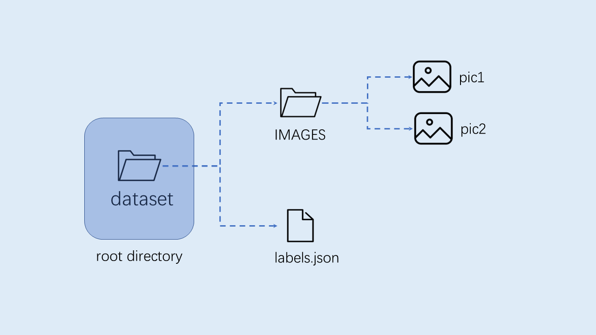

Note:

The object detection dataset is labeled in COCO format.

THE ROOT DIRECTORY OF THE DATASET INCLUDES THE IMAGES FOLDER AND THE LABELS.JSON FILE, AND ALL IMAGES ARE STORED IN THE IMAGES FOLDER;

### Model training and testing

This section is implemented in the training environment.

#### Create a virtual environment

Open the command terminal:

```Shell
conda create -n myenv python=3.9
conda activate myenv
```

#### Install the Python library

Install the Python library used for training according to the requriements .txt in the project, and wait for installation:

```Shell
pip install -r requriements.txt
```

In the requriments .txt, the model transformation packages nncase and nncase-kpu, a neural network compiler designed for AI accelerators, are installed.

#### Configure training parameters

The configuration file yaml/config.yaml in the given training script is set as follows:

```YAML
dataset:
   root_folder: ../data/fruit # 目标检测数据集路径
   origion_json: labels.json # 目标检测数据集标注json文件
   split: true # 是否重新执行拆分，第一次执行必须为true
   val_ratio: 0.1 # 验证集比例
   test_ratio: 0.1 # 测试集比例

 train_val_test:
   json_dir: ../gen # 拆分过程生成的训练集、验证集、测试集json文件，标签名称文件、校正集文件
   model_save_dir: ../checkpoints # 模型保存路劲
   gpu_index: 0 # 调用的gpu索引，如果gpu不可用，会使用cpu
   img_size: 640 # 分辨率
   learningrate: 0.001 #学习率
   mean: [ 0.485, 0.456, 0.406 ] # 图像标准化均值
   std: [ 0.229, 0.224, 0.225 ] # 图像标准化标准差
   epochs: 300 # 训练迭代次数
   nms_option: false #类内或者类间做nms false代表类内
   pre_train_dir: pre_pth # 预训练模型存放路径
   train_batch_size: 32 # 训练迭代batch
   val_batch_size: 8 # 验证迭代batch
   test_batch_size: 8 # 测试迭代batch

 inference:
   mode: image # 推理模式，分为image和video; image模式下可推理单张图片和目录下所有图片，video调用摄像头实现推理
   inference_model: best # 分为best和last，分别调用checkpoints下的best.pth和last.pth进行推理
   image_path: ../data/fruit/test.jpg # 如果该路径为图片路径，则进行单张图片推理；如果该路径为目录，则对目录下所有图片进行推理
   deploy_json: deploy.json # 后续kmodel需要读取的参数文件
   confidence_threshold: 0.55 # 检测框阈值
   nms_threshold: 0.2 # 最大值抑制阈值

 deploy:
   onnx_img_size: [640,640] # 转onnx输入分辨率 [w , h]  必须是32的倍数
   chip: k230 # 芯片类型，分为“k230”和“cpu”两种
   ptq_option: 0 # 量化类型，0为uint8，1，2，3，4为uint16的不同形式
```

#### Model training

Go to the project's scripts directory and execute the training code:

```Shell
python3 main.py
```

If the training is successful, you can find the trained last.pth, best.pth, best.onnx, and best.kmodel in the model_save_dir directory of the configuration file.

#### Model testing

Set the Inference section in the configuration file, set the test configuration, execute the test code:

```shell
python3 inference.py
```

#### Prepare the file

The files required for later deployment steps include:

（1）checkpoints/best.kmodel;

（2）gen/deploy.json;

(3) Test .jpg of the picture to be tested;

### CANMV K230 image compilation and burning

#### Docker environment setup

```Shell
# 下载docker编译镜像
docker pull ghcr.io/kendryte/k230_sdk
# 可以使用以下命令确认docker镜像是否拉取成功
docker images | grep ghcr.io/kendryte/k230_sdk
# 下载1.0.1版本sdk
git clone -b v1.0.1 --single-branch https://github.com/kendryte/k230_sdk.git
cd k230_sdk
# 下载工具链Linux和RT-Smart toolchain, buildroot package, AI package等
make prepare_sourcecode
# 创建docker容器，$(pwd):$(pwd)表示系统当前目录映射到docker容器内部的相同目录下，将系统下的工具链目录映射到docker容器内部的/opt/toolchain目录下
docker run -u root -it -v $(pwd):$(pwd) -v $(pwd)/toolchain:/opt/toolchain -w $(pwd) ghcr.io/kendryte/k230_sdk /bin/bash
```

#### Image compilation

```Shell
# 在docker容器中编译镜像耗时较长，请耐心等待完成
make CONF=k230_canmv_defconfig
```

#### Image burning

After the compilation is completed, you can find the compiled image file in the output/k230_canmv_defconfig/images directory:

```shell
k230_evb_defconfig/images
 ├── big-core
 ├── little-core
 ├── sysimage-sdcard.img    # SD卡启动镜像
 └──  sysimage-sdcard.img.gz # SD卡启动镜像压缩包
```

The CANMV K230 supports SDCard boot mode. To facilitate development, it is recommended that you prepare a TF card (Micro SD card).

**Linux:** If you use Linux to flash a TF card, you need to confirm the name of the SD card in the system /dev/sdx, and replace /dev/sdx in the following command

sudo dd if=sysimage-sdcard.img of=/dev/sdx bs=1M oflag=sync

**Windows:** If you are using Windows burning, it is recommended to use[the balena Etcher](https://etcher.balena.io/)tool. Download the generated sysimage-sdcard.img locally and burn it using the burning tool The balena Etcher.


After the burning is successful, a notification message will pop up. It is best to format the SD card before flashing.

### Power on the development board

Install MobaXterm to achieve serial communication, MobaXterm download address:<https://mobaxterm.mobatek.net> .


Insert the flashed SD card into the open board card slot, HDMI output to display, 100 Gigabit network port to Ethernet, POWER to serial port and power supply.

After the system is powered on, there will be**two serial devices by default**, which can be used to access small-core Linux and large-core RTSmart

The default user name of little core Linux is root, and the password is empty. The RTSmart system automatically launches an application and can exit`q` to the Command Prompt terminal by pressing the key.

### C++ code compilation

After completing the preparation of the above development board, we can use C++ to write our own code, the following takes the target detection task as an example, gives the sample code of the related object detection task, and briefly analyzes it. Sample code reference:<https://github.com/kendryte/K230_training_scripts/tree/main/end2end_det_doc/k230_code> .

#### Code structure

```shell
k230_code
 ├──cmake
     ├──link.lds #链接脚本
     ├──Riscv64.cmake
 ├──k230_deploy
     ├──ai_base.cc # 模型部署基类实现
     ├──ai_base.h # 模型部署基类，封装了nncase加载、input设置、模型推理、获取output操作，后续具体任务开发只需关注模型的前处理、后处理即可
     ├──anchorbase_det.cc # 目标检测code类实现
     ├──anchorbase_det.h # 目标检测类定义，继承AIBase，用于加载kmodel实现目标检测任务,封装模型推理的前后处理
     ├──main.cc # 主函数，参数解析，初始化AnchorBaseDet类示例，实现上板功能
     ├──scoped_timing.hpp # 时间测试工具
     ├──utils.cc # 工具类实现
     ├──utils.h # 工具类, 封装了图像预处理和目标检测任务的常用函数，包括读取二进制文件、保存图片、图像处理、结果绘制等，用户可根据自己需求丰富该文件
     ├──vi_vo.h # 视频输入输出头文件
     ├──CMakeLists.txt # CMake脚本用于构建一个使用C/C++源文件的可执行文件，并链接到各种库
 ├──build_app.sh # 编译脚本，使用交叉编译工具链编译k230_deploy工程
 ├──CMakeLists.txt # CMake脚本用于构建 nncase_sdk 的项目工程
```

#### Core code

- ai_base definition code of the AIBase class in the .h file. It mainly defines the kmodel interpreter, the relevant information of kmodel, as well as the interface definition of input and output settings and inference process. The specific implementation is in ai_base.cc.
- AnchorBaseDet in anchorbase_det.h is a class definition that implements the object detection task, mainly defining the pre-processing, inference, and post-processing interfaces of the object detection model reasoning. Initialize the AI2D builder implementation for image preprocessing. Some variables for the target detection task are also defined, such as the number of classes, label list, detection threshold, and so on. The specific implementation is in anchorbase_det.cc.
- The main.cc file is the main code to implement board-side inference, mainly to parse incoming parameters, print usage instructions, and realize inference of two different branches. If the second parameter input is an inference image path, the image_proc function is called for image inference, and if None is passed in, the video_proc function is called for video stream inference.
- Static graph inference code

```C++
void image_proc_ob_det(config_args args, char *argv[])
 {
     cv::Mat ori_img = cv::imread(argv[3]);
     int ori_w = ori_img.cols;
     int ori_h = ori_img.rows;
     vector<ob_det_res> results;
     AnchorBaseDet ob_det(args, argv[2], atoi(argv[4]));
     ob_det.pre_process(ori_img);
     ob_det.inference();
     ob_det.post_process({ori_w, ori_h}, results);
     Utils::draw_ob_det_res(ori_img,results);
     cv::imwrite("result_ob_det.jpg", ori_img);
 }
```

- Video stream inference code

```c++
void video_proc_ob_det(config_args args, char *argv[])
 {
     vivcap_start();
     k_video_frame_info vf_info;
     void *pic_vaddr = NULL;       //osd
     memset(&vf_info, 0, sizeof(vf_info));
     vf_info.v_frame.width = osd_width;
     vf_info.v_frame.height = osd_height;
     vf_info.v_frame.stride[0] = osd_width;
     vf_info.v_frame.pixel_format = PIXEL_FORMAT_ARGB_8888;
     block = vo_insert_frame(&vf_info, &pic_vaddr);
     // alloc memory
     size_t paddr = 0;
     void *vaddr = nullptr;
     size_t size = SENSOR_CHANNEL * SENSOR_HEIGHT * SENSOR_WIDTH;
     int ret = kd_mpi_sys_mmz_alloc_cached(&paddr, &vaddr, "allocate", "anonymous", size);
     if (ret)
     {
         std::cerr << "physical_memory_block::allocate failed: ret = " << ret << ", errno = " << strerror(errno) << std::endl;
         std::abort();
     }
     vector<ob_det_res> results;
     AnchorBaseDet ob_det(args, argv[2], {SENSOR_CHANNEL, SENSOR_HEIGHT, SENSOR_WIDTH}, reinterpret_cast<uintptr_t(vaddr), reinterpret_cast<uintptr_t(paddr), atoi(argv[4]));
     while (!isp_stop)
     {
         ScopedTiming st("total time", 1);

         {
             ScopedTiming st("read capture", atoi(argv[4]));
             // VICAP_CHN_ID_1 out rgb888p
             memset(&dump_info, 0 , sizeof(k_video_frame_info));
             ret = kd_mpi_vicap_dump_frame(vicap_dev, VICAP_CHN_ID_1, VICAP_DUMP_YUV, &dump_info, 1000);
             if (ret) {
                 printf("sample_vicap...kd_mpi_vicap_dump_frame failed.\n");
                 continue;
             }
         }
         {
             ScopedTiming st("isp copy", atoi(argv[4]));
             // 从vivcap中读取一帧图像到dump_info
             auto vbvaddr = kd_mpi_sys_mmap_cached(dump_info.v_frame.phys_addr[0], size);
             memcpy(vaddr, (void *)vbvaddr, SENSOR_HEIGHT * SENSOR_WIDTH * 3);
             kd_mpi_sys_munmap(vbvaddr, size);
         }
         results.clear();
         ob_det.pre_process();
         ob_det.inference();
         ob_det.post_process({SENSOR_WIDTH, SENSOR_HEIGHT},results);

         cv::Mat osd_frame(osd_height, osd_width, CV_8UC4, cv::Scalar(0, 0, 0, 0));
         cv::Mat osd_frame_tmp;

         {
             ScopedTiming st("osd draw", atoi(argv[4]));
             Utils::draw_ob_det_res(osd_frame, results, {osd_width, osd_height}, {SENSOR_WIDTH, SENSOR_HEIGHT});
         }


         {
             ScopedTiming st("osd copy", atoi(argv[4]));
             memcpy(pic_vaddr, osd_frame.data, osd_width * osd_height * 4);
             //显示通道插入帧
             kd_mpi_vo_chn_insert_frame(osd_id+3, &vf_info);  //K_VO_OSD0
             printf("kd_mpi_vo_chn_insert_frame success \n");
             ret = kd_mpi_vicap_dump_release(vicap_dev, VICAP_CHN_ID_1, &dump_info);
             if (ret) {
                 printf("sample_vicap...kd_mpi_vicap_dump_release failed.\n");
             }
         }
     }
     vo_osd_release_block();
     vivcap_stop();


     // free memory
     ret = kd_mpi_sys_mmz_free(paddr, vaddr);
     if (ret)
     {
         std::cerr << "free failed: ret = " << ret << ", errno = " << strerror(errno) << std::endl;
         std::abort();
     }
 }
```

The above code is the part of the main.cc that performs object detection operations on the video stream. Here is a detailed explanation:

- The vivcap_start() and vivcap_stop() functions are used to start and stop video capture;
- k_video_frame_info vf_info defines an k_video_frame_info structure variable vf_info that stores information about video frames;
- void *pic_vaddr = NULL defines a void pointer pic_vaddr for storing OSD (On*Screen Display) image data;
- memset(&vf_info, 0, sizeof(vf_info)) initializes the memory of the vf_info structure to zero, and then sets the information of the video frame, including width, height, stride, and pixel format.
- block = vo_insert_frame(&vf_info, &pic_vaddr) Call the vo_insert_frame function to insert frame data; kd_mpi_sys_mmz_alloc_cached function allocates a block of memory to store image data, paddr stores physical address, vaddr stores virtual address, size is the memory block size;
- Create an AnchorBaseDet object ob_det for object detection tasks;
- Create an empty results vector to store the object detection results.
- As soon as the isp_stop flag is not true, enter the loop:
  - a. Use kd_mpi_vicap_dump_frame to acquire one frame of image data from a video capture device, stored in the dump_info;
  - b. Copy the captured image data via kd_mpi_sys_mmap_cached and memcpy into the previously allocated memory block;
  - c. Clear the results vector, call the preprocessing, inference and post-processing methods of ob_det to perform object detection on the image;
  - d. Using the object detection results, draw the detection information on the OSD image;
  - e. use memcpy to copy OSD image data into previously allocated OSD data blocks;
  - f. Insert the OSD image into the display channel via kd_mpi_vo_chn_insert_frame;
  - g. Release previously captured images via kd_mpi_vicap_dump_release.
- After the loop ends, release OSD-related resources through the vo_osd_release_block() and vivcap_stop() functions;
- Use kd_mpi_sys_mmz_free to free previously allocated memory blocks.

The above code implements video stream inference for the object detection task.

k230_code/k230_deploy/CMakeLists.txt description

This is*the CMakeLists script in the k230 code/k230*deploy directory .txt set the compiled C++ file and the generated elf executable name, as follows:

```Shell
set(src main.cc utils.cc ai_base.cc anchorbase_det.cc)
set(bin main.elf)

include_directories(${PROJECT_SOURCE_DIR})：添加项目的根目录到头文件搜索路径中。
include_directories(${nncase_sdk_root}/riscv64/rvvlib/include)：添加 nncase RISC-V 向量库的头文件目录。
include_directories(${k230_sdk}/src/big/mpp/userapps/api/)：添加 k230 SDK 中的用户应用程序 API 头文件目录。
include_directories(${k230_sdk}/src/big/mpp/include)：添加 k230 SDK 的一般头文件目录。
include_directories(${k230_sdk}/src/big/mpp/include/comm)：添加与通信相关的头文件目录。
include_directories(${k230_sdk}/src/big/mpp/userapps/sample/sample_vo)：添加示例 VO（视频输出）应用程序头文件目录。

link_directories(${nncase_sdk_root}/riscv64/rvvlib/): 添加链接器搜索路径，指向 nncase RISC-V 向量库的目录。
add_executable(${bin} ${src}): 创建一个可执行文件，将之前设置的源文件列表作为输入。
target_link_libraries(${bin} ...)：设置可执行文件需要链接的库。列表中列出了各种库，包括 nncase 相关的库、k230 SDK 的库，以及其他一些库。
target_link_libraries(${bin} opencv_imgproc opencv_imgcodecs opencv_core zlib libjpeg-turbo libopenjp2 libpng libtiff libwebp csi_cv): 将一些 OpenCV 相关的库和其他一些库链接到可执行文件中。
install(TARGETS ${bin} DESTINATION bin): 安装生成的可执行文件到指定的目标路径（bin 目录）中。
```

k230_code/CMakeLists.txt description

```Shell
cmake_minimum_required(VERSION 3.2)
project(nncase_sdk C CXX)

set(nncase_sdk_root "${PROJECT_SOURCE_DIR}/../../nncase/")
set(k230_sdk ${nncase_sdk_root}/../../../)
set(CMAKE_EXE_LINKER_FLAGS "-T ${PROJECT_SOURCE_DIR}/cmake/link.lds --static")

# set opencv
set(k230_opencv ${k230_sdk}/src/big/utils/lib/opencv)
include_directories(${k230_opencv}/include/opencv4/)
link_directories(${k230_opencv}/lib ${k230_opencv}/lib/opencv4/3rdparty)

# set mmz
link_directories(${k230_sdk}/src/big/mpp/userapps/lib)

# set nncase
include_directories(${nncase_sdk_root}/riscv64)
include_directories(${nncase_sdk_root}/riscv64/nncase/include)
include_directories(${nncase_sdk_root}/riscv64/nncase/include/nncase/runtime)
link_directories(${nncase_sdk_root}/riscv64/nncase/lib/)

add_subdirectory(k230_deploy)
```

This is the CMakeLists .txt script in the k230_code directory. The script focuses on the following parts:

```Shell
set(nncase_sdk_root "${PROJECT_SOURCE_DIR}/../../nncase/"):设置nncase目录
set(k230_sdk ${nncase_sdk_root}/../../../):设置k230_sdk的目录，当前是从nncase目录的三级父目录得到
set(CMAKE_EXE_LINKER_FLAGS "-T ${PROJECT_SOURCE_DIR}/cmake/link.lds --static"):设置链接脚本路径，链接脚本放于k230_code/cmake下
...
add_subdirectory(k230_deploy): 添加待编译的工程子目录，如您要编译自己的工程，可以更换该行
```

k230_code/build_app.sh description

```Shell
#!/bin/bash
set -x

# set cross build toolchain
# 将交叉编译工具链的路径添加到系统的 PATH 环境变量中，以便在后续的命令中使用。该工具链是使用的大核编译工具链。
export PATH=$PATH:/opt/toolchain/riscv64-linux-musleabi_for_x86_64-pc-linux-gnu/bin/

clear
rm -rf out
mkdir out
pushd out
cmake -DCMAKE_BUILD_TYPE=Release                 \
      -DCMAKE_INSTALL_PREFIX=`pwd`               \
      -DCMAKE_TOOLCHAIN_FILE=cmake/Riscv64.cmake \
      ..

make -j && make install
popd

# 生成的main.elf可以在k230_code目录下的k230_bin文件夹下找到
k230_bin=`pwd`/k230_bin
rm -rf ${k230_bin}
mkdir -p ${k230_bin}

if [ -f out/bin/main.elf ]; then
      cp out/bin/main.elf ${k230_bin}
fi
```

#### Code compilation

Copy the k230_code folder in the project to src/big/nncase in the k230_sdk directory, execute the compilation script, and compile the C++ code into the main.elf executable.

```Shell
# 在k230_SDK根目录下执行
make CONF=k230_canmv_defconfig prepare_memory
# 回到当前项目目录，赋予权限
chmod +x build_app.sh
./build_app.sh
```

#### Prepare the ELF file

The files required for later deployment steps include:

1. k230_code/k230_bin/main.elf;

### Network configuration and file transfer

There are two ways to copy the files to be used to the board. One is the TFTP transfer method and the other is the SCP transfer method.

#### TFTP file transfer

- Windows system PC network configuration

Control Panel - > Network and Sharing Center - > Change Adapter Settings - > Ethernet Network Card - > Right-click Properties - > Selected (TCP/IPv4) - > Properties

Configure the IP address, mask, gateway, and DNS server address:

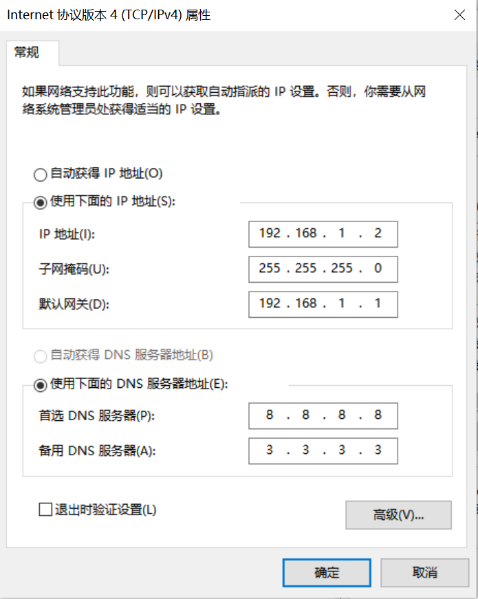

- Development board network configuration

Go to the little core command line and execute:

```Shell
# 查看是否有eth0
ifconfig
# 配置开发板IP，和PC在同一网段下
ifconfig eth0 192.168.1.22
# 查看IP配置
ifconfig
```

- Tool: TFTPD64

Install the TFTP communication tool, download address:<https://bitbucket.org/phjounin/tftpd64/downloads/>

Start TFTPD64 and configure the directory and service NIC for files to be transferred

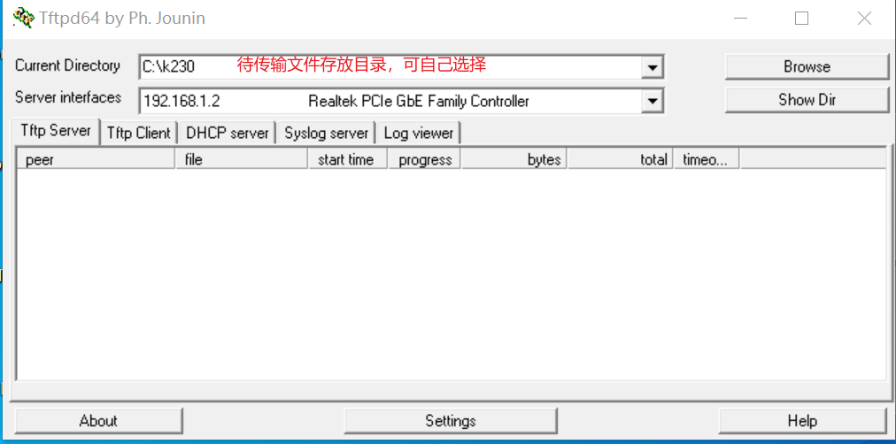

- ShareFs instructions

```Shell
# 进入小核根目录
cd /
# 查看目录
ls
# sharefs目录是大小核共用目录，因此从小核拷贝到sharefs目录下的文件对大核也可见
```

- File transfer

```Shell
# 以下代码在小核串口执行
# 将PC上tftpd64配置文件存放目录中的文件传输至开发板的当前目录
tftp -g -r your_file 192.168.1.2
# 将开发板当前目录下的文件传输至tftpd64配置文件存放目录
tftp -p -r board_file 192.168.1.2
```

#### SCP file transfer

In the Linux system, the PC is normally connected to the network, and the development board can be connected to other network ports under the gateway where the PC is located through the network cable, and file transfer can be realized through the scp command.

Power on the development board, enter the COM interface of large and small cores, and execute the scp transmission command on the little core:

```Shell
# 从PC拷贝文件至开发板
scp 用户名@域名或IP:文件所在目录 开发板目的目录
#拷贝文件夹
scp -r 用户名@域名或IP:文件所在目录 开发板目的目录
# 从开发板拷贝文件至PC
scp 开发板待拷贝目录 用户名@域名或IP:PC目的目录
# 拷贝文件夹
scp -r 开发板待拷贝目录 用户名@域名或IP:PC目的目录
```

### K230 side deployment

#### Board-side deployment process

Follow the file transfer process configured in the previous section, enter /sharefs on the little core interface on MobaXterm, and create a test folder:

```Shell
cd /sharefs
mkdir test_det
cd test_det
```

Copy the prepared files in the model training and testing section and the elf files prepared in the C++ code compilation section to the development board.

```shell
test_det
 ├──best.kmodel
 ├──deploy.json
 ├──main.elf
 ├──test.jpg
```

Enter the /sharefs/test_det directory at the big core COM port,

To perform static graph inference, execute the following code (note: the code needs to be executed under the big core, and the file copy needs to be completed under the little core):

```Shell
"模型推理时传参说明：<config_file> <kmodel_det> <input_mode> <debug_mode>"
"Options:"
"  config_file     部署所用json配置文件,默认为 deploy_config.json"
"  kmodel_det      kmodel路径"
"  input_mode      本地图片(图片路径)/ 摄像头(None)"
"  debug_mode      是否需要调试，0、1、2分别表示不调试、简单调试、详细调试"
main.elf deploy.json best.kmodel test.jpg 2
```

To perform camera video stream inference, execute the following code:

```Shell
main.elf deploy.json best.kmodel None 2
```

#### Effect of deployment on the board

Static graph reasoning effect:


## Frequently Asked Questions (FAQs)

### TF boot failed with exit code 13

Problem: TF card boot fails with exit code 13 error

Answer: The reasons are as follows: 1. The file error in the boot media. 2. The startup pin is set incorrectly.

### Bootrom boot error code

Question: What does the bootrom boot error code mean?

When bootROM fails to boot, it will print an error similar to the following boot failed with exit code 19, the last number is the cause of the error, and the common error meaning is as follows

| value   | meaning                                                |
| ---- | --------------------------------------------------- |
| 13   | The boot media contains a file error                                |
| 19   | Boot media initialization failed, such as not inserting an SD card                |
| 17   | The OTP requirement must be a secure image, but the files on the media are non-secure images |

### perf use

Question: How is perf compiled and what hardware events are supported?

A: The reference image with PERF function is linked below<https://kvftsfijpo.feishu.cn/file/LJjpbwxnzowI9RxvL0NcEK73nkf?from=from_copylink>

When perf, you can use the RAW event, such as perf stat -e r12, and the perf tool compile command as follows

```bash
cd src/little/linux/tools
make CROSS_COMPILE=riscv64-unknown-linux-gnu- ARCH=riscv perf V=1 WERROR=0
#copy perf/perf file to board
```

Special note: Versions prior to 1.1 have the following modifications

```bash
#src/little/linux/arch/riscv/boot/dts/kendryte/k230_evb.dtsi add
pmu_thead: pmu_thead {
    interrupt-parent = <&cpu0_intc>;
    interrupts = <17>;
    compatible = "thead,c900_pmu";
};
#src/little/linux/arch/riscv/configs/k230_evb_defconfig  add
CONFIG_KALLSYMS=y
CONFIG_KALLSYMS_ALL=y
CONFIG_PERF_EVENTS=y
CONFIG_DEBUG_PERF_USE_VMALLOC=y
CONFIG_KUSER_HELPERS=y
CONFIG_DEBUG_INFO=y
CONFIG_FRAME_POINTER=y
```

```bash
[root@canaan ~ ]#perf list hw cache  > a ;cat a
  branch-instructions OR branches                    [Hardware event]
  branch-misses                                      [Hardware event]
  bus-cycles                                         [Hardware event]
  cache-misses                                       [Hardware event]
  cache-references                                   [Hardware event]
  cpu-cycles OR cycles                               [Hardware event]
  instructions                                       [Hardware event]
  ref-cycles                                         [Hardware event]
  stalled-cycles-backend OR idle-cycles-backend      [Hardware event]
  stalled-cycles-frontend OR idle-cycles-frontend    [Hardware event]
  L1-dcache-load-misses                              [Hardware cache event]
  L1-dcache-loads                                    [Hardware cache event]
  L1-dcache-store-misses                             [Hardware cache event]
  L1-dcache-stores                                   [Hardware cache event]
  L1-icache-load-misses                              [Hardware cache event]
  L1-icache-loads                                    [Hardware cache event]
  LLC-load-misses                                    [Hardware cache event]
  LLC-loads                                          [Hardware cache event]
  LLC-store-misses                                   [Hardware cache event]
  LLC-stores                                         [Hardware cache event]
  dTLB-load-misses                                   [Hardware cache event]
  dTLB-loads                                         [Hardware cache event]
  dTLB-store-misses                                  [Hardware cache event]
  dTLB-stores                                        [Hardware cache event]
  iTLB-load-misses                                   [Hardware cache event]
  iTLB-loads                                         [Hardware cache event]
[root@canaan ~ ]#

```

### Big Core runs Vector Linux

Question: How does Big Core run Linux with Vector?

Answer: make CONF=k230_evb_only_linux_defconfig ; The compiled image, the big core runs Linux with vector by default.

### Big core serial port ID

Question: How to modify the serial port ID of the big core?

Answer: The configuration file below configs CONFIG_RTT_CONSOLE_ID stands for the big core serial port ID, modify it to the correct value.

### uboot command line

How to compile the version that can enter the uboot command line

Answer: The configuration file below configs CONFIG_QUICK_BOOT stands for fast, modify it to CONFIG_QUICK_BOOT=n to generate a command-line version that can be entered into uboot.

### How to start slowly and start faster

Answer: Enter the uboot command line and execute the following command:

```bash
setenv quick_boot true;saveenv;reset;
```

### How Linux modifies the last partition size

Answer: You can use the parted tool to dynamically modify the size of the last partition, refer to the following command:

```bash
umount /sharefs/
parted   -l /dev/mmcblk1
parted  -a minimal  /dev/mmcblk1  resizepart 4  31.3GB
mkfs.ext2 /dev/mmcblk1p4
mount /dev/mmcblk1p4 /sharefs
#reference log
[root@canaan ~ ]#parted   -l /dev/mmcblk1
Model: SD SD32G (sd/mmc)
Disk /dev/mmcblk1: 31.3GB
Sector size (logical/physical): 512B/512B
Partition Table: gpt
Disk Flags:

Number  Start   End     Size    File system  Name        Flags
 1      10.5MB  31.5MB  21.0MB               rtt
 2      31.5MB  83.9MB  52.4MB               linux
 3      134MB   218MB   83.9MB  ext4         rootfs
 4      218MB   487MB   268MB   fat16        fat32appfs


[root@canaan ~ ]#umount /sharefs/
[root@canaan ~ ]#parted  -a minimal  /dev/mmcblk1  resizepart 4  31.3GB
Information: You may need to update /etc/fstab.

[root@canaan ~ ]#parted   -l /dev/mmcblk1
Model: SD SD32G (sd/mmc)
Disk /dev/mmcblk1: 31.3GB
Sector size (logical/physical): 512B/512B
Partition Table: gpt
Disk Flags:

Number  Start   End     Size    File system  Name        Flags
 1      10.5MB  31.5MB  21.0MB               rtt
 2      31.5MB  83.9MB  52.4MB               linux
 3      134MB   218MB   83.9MB  ext4         rootfs
 4      218MB   31.3GB  31.1GB  fat16        fat32appfs


[root@canaan ~ ]#mkfs.ext2 /dev/mmcblk1p4
Filesystem label=
OS type: Linux
Block size=4096 (log=2)
Fragment size=4096 (log=2)
1896832 inodes, 7586811 blocks
379340 blocks (5%) reserved for the super user
First data block=0
Maximum filesystem blocks=8388608
232 block groups
32768 blocks per group, 32768 fragments per group
8176 inodes per group
Superblock backups stored on blocks:
32768, 98304, 163840, 229376, 294912, 819200, 884736, 1605632, 2654208, 4096000
[root@canaan ~ ]#parted   -l /dev/mmcblk1
Model: SD SD32G (sd/mmc)
Disk /dev/mmcblk1: 31.3GB
Sector size (logical/physical): 512B/512B
Partition Table: gpt
Disk Flags:

Number  Start   End     Size    File system  Name        Flags
 1      10.5MB  31.5MB  21.0MB               rtt
 2      31.5MB  83.9MB  52.4MB               linux
 3      134MB   218MB   83.9MB  ext4         rootfs
 4      218MB   31.3GB  31.1GB  ext2         fat32appfs


[root@canaan ~ ]#mount /dev/mmcblk1p4 /sharefs/
[  332.688642] EXT4-fs (mmcblk1p4): mounted filesystem without journal. Opts: (null)
[root@canaan ~ ]#df -h
Filesystem                Size      Used Available Use% Mounted on
/dev/root                73.5M     60.9M     10.2M  86% /
devtmpfs                 41.7M         0     41.7M   0% /dev
tmpfs                    51.8M         0     51.8M   0% /dev/shm
tmpfs                    51.8M     56.0K     51.7M   0% /tmp
tmpfs                    51.8M     36.0K     51.7M   0% /run
/dev/mmcblk1p4           28.5G     20.0K     27.0G   0% /sharefs
[root@canaan ~ ]#

```

### How to modify bootargs

Answer: Method 1: Modify bootargs using env file. For example, you can add the following content to the board/common/env/default.env file:

```bash
bootargs=root=/dev/mmcblk1p3 loglevel=8 rw rootdelay=4 rootfstype=ext4 console=ttyS0,115200 earlycon=sbi；
```

Method 2: Enter the uboot command line and modify bootargs with reference to the following command.

```bash
setenv bootargs  "root=/dev/mmcblk1p3 loglevel=8 rw rootdelay=4 rootfstype=ext4 console=ttyS0,115200 earlycon=sbi" ;saveenv;reset;
```

### How to view bootargs

Answer: Method 1: Under linux, enter cat /proc/cmdline to view

```bash
[root@canaan ~ ]#cat /proc/cmdline
root=/dev/mmcblk0p3 loglevel=8 rw rootdelay=4 rootfstype=ext4 console=ttyS0,115200 crashkernel=256M-:128M earlycon=sbi
[root@canaan ~ ]#

```

Method 2: Linux command line input dmesg | grep command view

```bash
[root@canaan ~ ]#dmesg | grep  command
[    0.000000] Kernel command line: root=/dev/mmcblk0p3 loglevel=8 rw rootdelay=4 rootfstype=ext4 console=ttyS0,115200 crashkernel=256M-:128M earlycon=sbi
[root@canaan
```

### The little core is modified by default serial port

Answer: At present, the little core serial port in the SDK defaults to 0, if you need to modify it to other serial ports (such as serial port 2), please refer to the following to modify:

Modification 1: Refer to the following to modify the uboot device tree (e.g. arch/riscv/dts/k230_evb.dts):

```bash
aliases {
        uart2 = &serial2;
    };

    chosen {
        stdout-path = "uart2:115200n8";
    };

    serial2: serial@91402000 {
    compatible = "snps,dw-apb-uart";
    reg = <0x0 0x91402000 0x0 0x400>;
    clock-frequency = <50000000>;
    clock-names = "baudclk";
    reg-shift = <2>;
    reg-io-width = <4>;
    u-boot,dm-pre-reloc;
};
```

Modification 2: Refer to the following to modify the Linux device tree (e.g. arch/riscv/boot/dts/kendryte/k230_evb.dts)

```bash
aliases {
        serial2 = &uart2;
    };
chosen {
        stdout-path = "serial2";
    };

&uart2 {
    status = "okay";
};
```

Modification 3: Modify bootargs using env files (see 2.10).

 For example, you can add the following content to the board/common/env/default.env file:

```bash
bootargs=root=/dev/mmcblk1p3 loglevel=8 rw rootdelay=4 rootfstype=ext4 console=ttyS2,115200 earlycon=sbi；
```

### How to completely recompile the SDK

Answer: After updating and modifying the SDK source code, or after modifying the SDK source code, it is recommended to enter the following command to completely recompile the SDK.

```bash
make clean; make;
```

Special note: The SDK does not support multi-process compilation, do not add multi-process compilation options like -j32.
