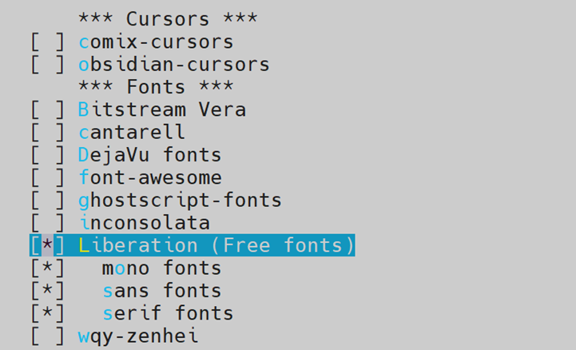
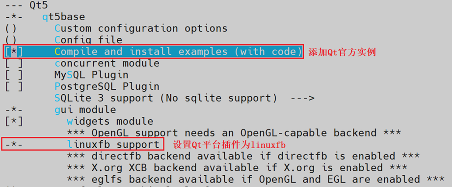
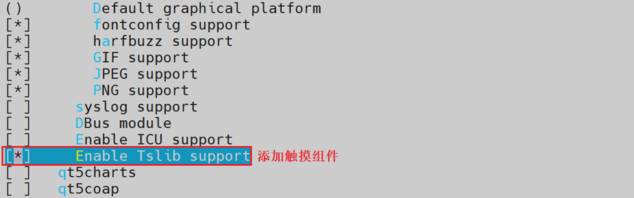
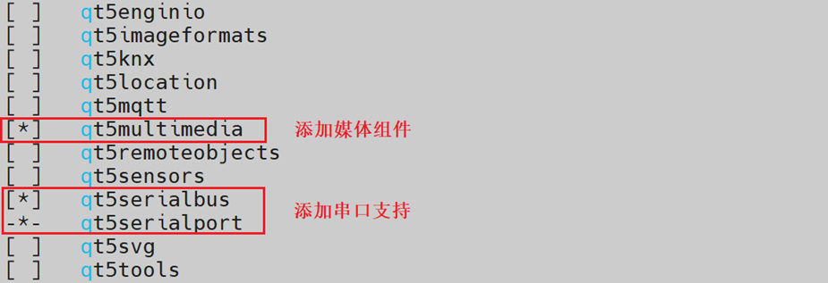
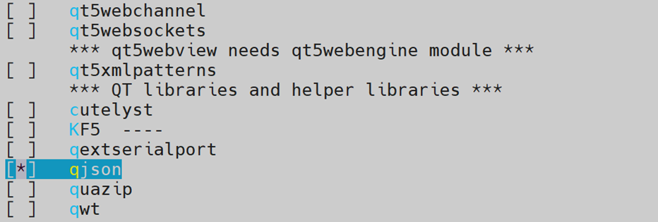

# K230 Qt移植指南

## Qt简介

Qt是一个跨平台的C++图形用户界面应用程序开发框架。它既可以开发GUI程序，也可用于开发非GUI程序，比如控制台工具和服务器。Qt是面向对象的框架，并且很容易进行扩展，允许真正地组件编程

### Qt GUI特点

1. 优良的跨平台特性，支持Windows、Linux、FreeBSD

1. 使用面向对象机制

1. 丰富的组件支持，Qt包含250个以上的C++类

## Qt移植说明

本文主要介绍如何通过buildroot添加Qt 5.15支持

### 进入buildroot配置界面

k230_sdk主目录下，运行如下命令：

```sh

make buildroot-menuconfig

```

### 添加字库支持

点击Target packages --> Fonts, cursors, icons, sounds and themes

下图所示为字库配置界面：



尽量选择免费字库，减少后续的版权纠纷

### 添加Qt 5组件

点击Target packages --> Graphic libraries and applications (graphic/text) --> Qt 5，选择如下配置选项：

下图所示为Qt配置界面：






### 保存buildroot配置信息

k230_sdk主目录下，运行如下命令：

```sh

make buildroot-savedefconfig

```

### 查看buildroot配置选项

字库和Qt添加成功后，buildroot配置文件如下所示：

```sh

BR2_PACKAGE_QT5=y
BR2_PACKAGE_QT5BASE_EXAMPLES=y
BR2_PACKAGE_QT5BASE_WIDGETS=y
BR2_PACKAGE_QT5BASE_FONTCONFIG=y
BR2_PACKAGE_QT5BASE_HARFBUZZ=y
BR2_PACKAGE_QT5BASE_GIF=y
BR2_PACKAGE_QT5BASE_JPEG=y
BR2_PACKAGE_QT5BASE_PNG=y
BR2_PACKAGE_QT5BASE_TSLIB=y
BR2_PACKAGE_QT5MULTIMEDIA=y
BR2_PACKAGE_QT5SERIALBUS=y
BR2_PACKAGE_QJSON=y

```

## 添加环境变量和JSON配置文件

### 添加Qt环境变量

```c

export QT_QPA_FB_DRM=1
export QT_QPA_EGLFS_KMS_ATOMIC=1
export QT_QPA_EGLFS_KMS_CONFIG=/etc/qt_config.json
export QT_QPA_FONTDIR=/usr/share/fonts
export QT_QPA_PLATFORM=linuxfb:rotation=0
export QT_ROOT=/usr/lib/qt
export QT_QPA_PLATFORM_PLUGIN_PATH=$QT_ROOT/plugins
export QT_QPA_GENERIC_PLUGINS="tslib:/dev/input/event0"
export XDG_RUNTIME_DIR=/tmp
export RUNLEVEL=3
export QT_DEBUG_PLUGINS=1
export QT_LOGGING_RULES="qt.qpa.*=true"

```

将上述环境变量保存到开发板文件系统/etc/profile文件中，使得环境变量可以开机生效

下图所示为相关环境变量解释：

1. QT_QPA_FB_DRM=1：由于Framebuffer驱动已经被Linux内核废弃，因此绝大部分SOC芯片的显示驱动都使用DRM架构，设置QT_QPA_FB_DRM环境变量为1，表示Qt使用DRM驱动以及libdrm库

1. QT_QPA_EGLFS_KMS_ATOMIC=1：表示使用DRM驱动的atomic API，而不是默认的legacy API

1. QT_QPA_EGLFS_KMS_CONFIG=/etc/qt_config.json：设置JSON配置文件的绝对路径

1. QT_QPA_FONTDIR=/usr/share/fonts：设置字库的绝对路径

1. QT_DEBUG_PLUGINS=1：表示Qt在加载插件时，输出调试信息，这样可以方便地知道Qt加载了哪些插件，哪些插件加载成功，哪些插件加载失败，插件加载失败的原因是什么等等非常多的调试信息。

1. QT_LOGGING_RULES="qt.qpa.*=true"：打开Qt图形和输入子系统的日志记录

### 添加JSON配置文件

```c

{
  "device": "/dev/dri/card0",
  "outputs": [
    { "name": "DSI1", "mode": "1080x1920", "size": "1080x1920", "format": "rgb565", "physicalWidth": 68, "physicalHeight": 120}
  ]
}

```

需要特别注意以下字段：

name：显示屏通过DSI1进行连接，类似的连接参数还有：HDMI1、DP1、VGA1、LVDS1，请根据实际情况进行选择

format：设置Qt显示缓冲区的颜色空间，这个需要通过查询DRM显示控制器的图层参数获得

physicalWidth和physicalHeight：设置显示屏的物理尺寸，单位为毫米
